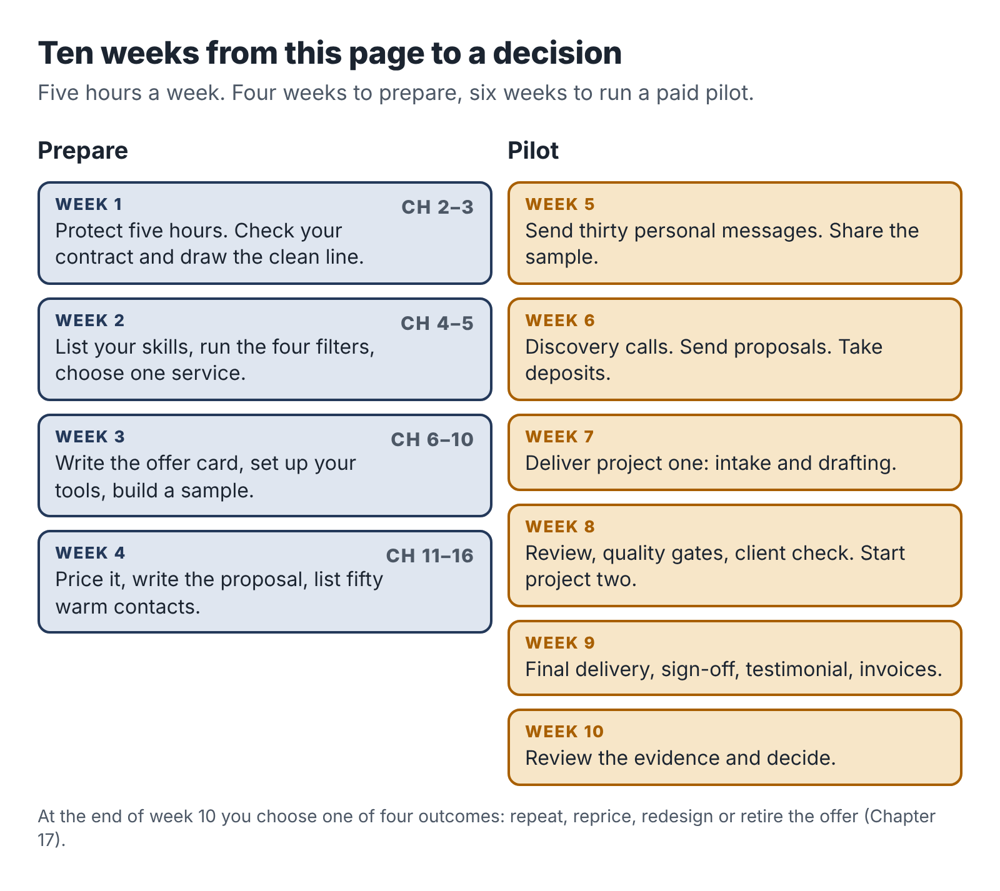

# Introduction: five hours after five

Most side-hustle advice about AI is written for someone who does not exist. That person has no boss, no contract, no commute and no children who need dinner at six. They have unlimited evenings and no fear of getting it wrong. They can try twelve ideas in a month, post daily videos about it and pivot on a whim.

You have a job.

The job pays the rent, carries your health insurance or your pension, and takes most of your best hours. It probably came with a contract you signed in a hurry, a laptop that belongs to someone else, and a manager who may or may not be relaxed about you doing paid work on the side. You might have a visa tied to that job. You might work in a field where outside business activity has to be reported. You almost certainly have less free time than the person in the YouTube thumbnail.

And yet you have something that person usually lacks. You know how to do a piece of real work well. You have done it for years, for money, for people who would have complained if it was wrong. Maybe you write the procedures nobody else wants to write. Maybe you are the one who cleans up the spreadsheet before the board meeting, or who knows how to make the CRM send the right email at the right time, or who can read forty pages of vendor material and say in one paragraph which option is better and why.

That skill is the start of a business. AI tools can make it faster to deliver. They cannot supply the skill, the judgment or the trust, and those are the parts people pay for.

This book shows you how to turn one skill you already have into a small, paid, fixed-scope service that you can run in about five hours a week, with AI doing some of the heavy lifting, while you keep your job and your good name. It is a narrow promise on purpose.

## What this book is, and what it is not

It is a plan for building a service business: you do a defined piece of work for a client, they pay you, and you do it again for someone else. A service is the fastest legitimate way for an employed person to earn their first dollar outside a paycheck. It needs almost no money to start. You learn what buyers want by talking to them, which no product launch can teach you as quickly. And when something goes wrong, you can fix it by hand.

It is not a book about passive income, faceless YouTube channels, printing AI-written books by the dozen, drop-shipping or trading. It will not tell you that you can make ten thousand dollars a month by next quarter. Some people do build large businesses on the side, and the last chapter talks about what happens if yours grows. But the evidence on side income is sobering. Bankrate's 2025 survey of 2,616 American adults found that 27 percent had a side hustle, down from 39 percent in 2023, and the average side hustler earned $885 a month. Averages like that are pulled up by a few big earners; reported median figures are far lower. A book that promises you the top of that range on a few hours a week is selling you something.

What a few focused hours can realistically do is this: produce a few hundred to a couple of thousand dollars a month from a service you are proud of, with a clear record of what each hour earned you, and without putting your main income at risk. For many readers that money pays down a debt, builds a cushion or funds a goal. For some it becomes the first proof that they could one day work for themselves. Both outcomes are worth having, and you will know within about ten weeks which way you are heading.

## The four promises

The plan in this book rests on four promises you make to yourself before you sell anything.

The first is a time budget. You decide how many hours a week the business gets, you put them in your calendar, and you cap the number of clients so that the budget holds. The default in this book is five hours: two working sessions of two hours each and one hour of admin. If you have more, use more. If you have less, the plan still works, just more slowly.

The second is a clean line between your employer and your business. Your business runs on your own devices, your own accounts, your own time and your own knowledge. It does not touch your employer's clients, data, software, confidential information or working hours. Chapter 3 walks through how to check your contract and when to disclose.

The third is a fixed scope. You sell a defined outcome with a known set of inputs, a delivery date and a revision limit. You do not sell "help with AI" or open-ended hours. A fixed scope is what lets you price fairly, deliver inside five hours a week and say no without guilt.

The fourth is honest measurement. You record every hour, including the hours spent finding clients, writing proposals, fixing mistakes and chasing invoices. At the end of a pilot you look at what the work really paid per hour and decide, from evidence, whether to repeat, reprice, redesign or retire the offer.

None of these is exciting. All of them separate the people who still have a side business a year later from the people who gave up without a word in month three.

## How the book is organized

Part One, Clear the ground, is about the three things you have to settle before you build: what AI really changes about service work, where your five hours will come from, and where the line sits between you and your employer.

Part Two, Shape the offer, turns a skill you already use at work into a fixed-scope service someone can buy. It includes a catalogue of twelve services that fit an evening schedule, with notes on who buys each one and what can go wrong.

Part Three, Build it and prove it, sets up a small tool kit and then follows three worked pilots from start to finish: a process manual built from a recorded interview, a research brief built from public sources, and a small automation with a person approving every message before it goes out. You will see the prompts, the review steps, the mistakes and the time logs.

Part Four, Find and serve clients, covers finding your first buyers without broadcasting your plans to your employer, running a discovery call, writing a one-page proposal, setting a price and delivering work you can put your name on, including how to protect client information.

Part Five, Run it like a business, deals with money, tax and paperwork, how to measure the job you actually did, a six-week pilot plan with a clear decision at the end, and how to grow (or deliberately stay small) without burning out.

At the back is a Toolkit with every worksheet and template in the book, ready to copy, and a set of notes listing the studies and sources behind the facts.

Each chapter ends with a short section called "Your next session." It tells you what to do in your next two-hour block. If you follow those sections in order, you will go from reading this page to a decision about a real, paid offer in about ten weeks.

## The people you will meet

You will follow three people through the book. Each is a composite built from common situations.

Dana Okafor is an operations coordinator at a regional logistics company. She writes and maintains standard operating procedures for warehouse staff. Her side offer turns the know-how in a small trade-business owner's head into a short, usable process manual.

Ravi Menon is a procurement analyst for a university. He compares suppliers for a living. His side offer is a dated, sourced comparison brief that helps small nonprofits choose software, and he has to work around a real conflict of interest to do it.

Teresa Alvarez runs sales operations at a software company and administers its CRM. Her side offer sets up a simple enquiry-handling system for independent wedding and portrait photographers, with AI drafting replies and the photographer approving each one.

You will also meet a few people whose stories go less well. Their mistakes are as useful as the successes.

## A word about AI

The tools change every few months. By the time you read this, some of the products named here will have new names, new prices and new features, and a few will be gone. For that reason this book teaches methods that work with any capable AI assistant: how to brief it, what to check, what never to paste into it, and how to fit it into a service so that a person stays responsible for the result.

The research on AI at work, which Chapter 1 goes through in more detail, points one way. These tools make some tasks much faster, and they make confident mistakes on others. In one large experiment, consultants using AI did better on tasks the tools handle well and worse on a task the tools handle badly, because they trusted output they should have checked. The people who earn well from AI-assisted services are the ones who know which is which.

That judgment is what your years in a job have given you. Let's put it to work.
