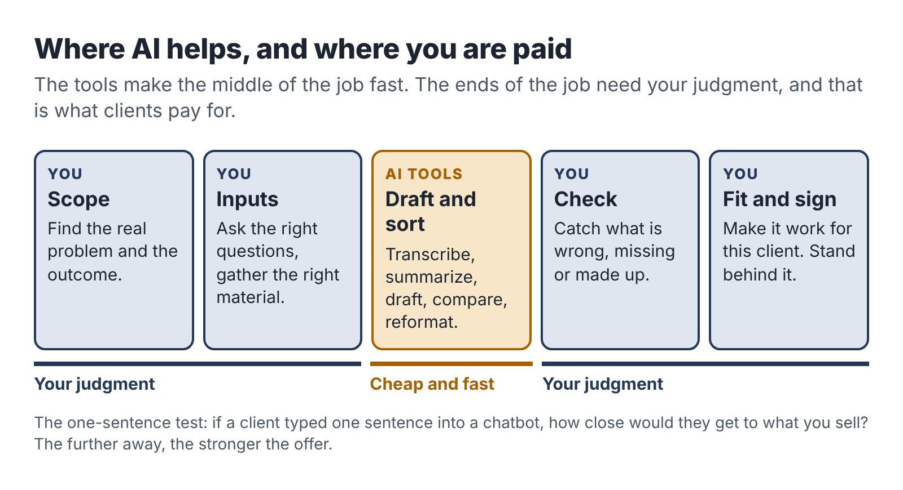

# 1. What AI changed, and what it didn't

In the spring of 2023, two economists at MIT ran an experiment that has been quoted in nearly every serious article about AI and work since. Shakked Noy and Whitney Zhang recruited 453 college-educated professionals (marketers, grant writers, consultants, data analysts, HR staff and managers) and asked each of them to complete writing tasks from their own line of work: a press release, a short report, an analysis email. Half were given access to ChatGPT. The results, published in *Science* that July, were striking. People with the tool finished about 40 percent faster, and independent graders rated their work about 18 percent better.

If you stop reading there, you might conclude that anyone with a chatbot can now sell writing, analysis or consulting at a profit. A lot of side-hustle courses stopped reading there.

Keep going and the picture gets more interesting.

## Three findings worth knowing

The first finding is about who gains. In Noy and Zhang's study, the weaker writers improved the most; the gap between the best and worst participants narrowed. A larger field study by Erik Brynjolfsson, Danielle Li and Lindsey Raymond found the same pattern among more than five thousand customer-support agents at a software company. An AI assistant raised the number of issues resolved per hour by about 14 percent on average, and by about 34 percent for the newest and least skilled agents. The most experienced agents gained very little.

Read that carefully, because it cuts against a common assumption. AI helps people reach a competent standard faster. It does much less for people who are already good. So if your plan is to sell *competent text*, you are selling something AI has made cheap and plentiful. If your plan is to sell the kind of expert judgment that the best agents already had, AI will speed up your delivery, but the judgment is still yours to supply.

The second finding is about mistakes. In 2023 a team from Harvard Business School, Wharton and other schools ran an experiment with 758 consultants from Boston Consulting Group. On a set of realistic consulting tasks that the AI handled well, consultants using GPT-4 completed about 12 percent more tasks, worked about 25 percent faster and produced work rated substantially higher in quality. But the researchers also included one task designed to sit just outside what the AI could do reliably: a business problem where the right answer depended on noticing details in interview notes and spreadsheet data that contradicted a surface reading. On that task, consultants who used AI were markedly *less* likely to reach the correct answer than consultants who worked without it, a drop of roughly 19 percentage points in one of the AI conditions.

The authors called this a "jagged frontier." Inside the frontier, AI makes people faster and better. Just outside it, the tool still writes a fluent, confident answer, and people accept it. The danger is that the frontier is invisible. Nothing in the output tells you which side you are on.

The third finding is about the market. Xiang Hui, Oren Reshef and Luofeng Zhou studied what happened to freelancers on a large online work platform after ChatGPT was released. Freelancers in writing-related categories saw the number of jobs they won fall by about 2 percent and their monthly earnings fall by about 5 percent, relative to freelancers in less exposed work. The release of image-generation tools had a similar effect on image work. The study measures the short term, and the effects were modest, but the direction is clear. When a client can get an acceptable first draft for free, they stop paying someone else for first drafts.

## So what are people still paying for?

Put those three findings side by side and a simple picture appears.

AI made *words* cheap: first drafts, summaries, outlines, lists of ideas, rewrites in a friendlier tone, boilerplate code. Anyone can now get those in seconds, and a growing share of your future clients already do.

AI did not make *responsibility* cheap. Someone still has to know what the client really needs, gather the right inputs, notice when the output is wrong, check facts against sources, fit the result into the client's real situation, take the call when something breaks, and put their name on the finished work. Those are the parts that fall outside the frontier, and they are the parts where years of doing a job make you better than a beginner with a better tool.

That gives you a simple test for any AI-assisted service idea. Ask: *if the client opened a chatbot themselves and typed one sentence, how close would they get to what I am selling?* If the honest answer is "most of the way," the offer is weak. If the answer is "they would get a plausible draft, but they would not know what to ask, what to check, what was missing or how to make it work in their business," you have something.

## Four myths to drop now

### Myth one: AI lets you sell skills you don't have

The BCG study shows the risk. When people relied on AI for work they could not evaluate, they got worse results and did not notice. A client who pays you for a marketing plan, a legal summary or a financial model is trusting your judgment. If you cannot judge the output, you cannot sell it. This book's plan starts from a skill you already use at work for exactly this reason.

### Myth two: the money is in volume

Ten-dollar blog posts, a hundred AI-written listings a day, fifty cold emails an hour. Volume work is the first to be squeezed by cheaper tools and cheaper competitors, and it eats evening hours at a terrible rate. On five hours a week you need a small number of clients paying a fair price for something specific.

### Myth three: you should hide that you use AI

Some freelancers worry that clients will pay less if they know. In practice, the bigger risk runs the other way. Clients who discover undisclosed AI use, especially through a mistake, tend to feel deceived, and some contracts and industries now require disclosure. Chapter 14 shows how to explain your process in a way that builds trust: what the tools do, what you do, and how you check the result.

### Myth four: the tools are the business

People spend weeks comparing AI products, building prompt libraries and setting up automation before they have a single buyer. Tools are cheap and replaceable. A buyer with a problem you can solve is neither, and that is where the first weeks of effort belong.

## What a good AI-assisted service looks like

The services that work for employed people, including the three pilots in Part Three, tend to share five traits.

1. A clear outcome. The client receives something they can name and use: a process manual for three jobs, a twelve-page comparison of four software options, a working enquiry system with a one-page guide.
2. Inputs you can control. You know what you need from the client before you start: a recorded interview, a list of three vendors, access to a form and an inbox. You are not waiting on vague material that may never arrive.
3. AI on the repetitive middle. The tools transcribe, sort, draft, reformat and compare. That middle is where much of the time goes in the old way of doing the work, and it is where AI is most reliably good.
4. You on the ends. You scope the work at the start and check, correct and fit the result at the end. Those steps are where your judgment is visible to the client and where the price is justified.
5. A limit on time. The work fits in a few evening sessions, with a fixed number of revisions, so that one client cannot swallow your week.

Notice what is missing from that list: anything about a particular AI product. A good service survives a change of tools. If your favorite assistant doubled its price tomorrow, you would switch, lose an afternoon and carry on.

## A short story about the frontier

Jordan, a marketing coordinator at a hotel group, started an evening business in 2024 writing blog posts for small dental and physiotherapy clinics. The posts were fluent and on-topic, and an AI assistant produced a first draft in minutes. Jordan charged sixty dollars a post and found six clients in a month.

By month three, two problems had arrived together. A physiotherapist noticed that one article described an exercise in a way that could aggravate the very injury it claimed to treat. Another client had been told by an SEO consultant that their posts looked like everybody else's posts on the same topics. Jordan had no medical training and had been checking the drafts for grammar and tone, which were never the problem. The clinic owner did not shout. They simply stopped paying.

Jordan's mistake was neither laziness nor dishonesty. It was selling something outside his own frontier. He was very good at a hotel's voice and guest communication, and that was a sellable skill. He was not qualified to judge clinical content, and the AI could not supply that judgment for him.

The next chapters will help you avoid Jordan's route. You will choose a skill that is clearly yours, shape it into an offer AI can speed up but cannot replace, and put your checking where it counts.

::: session
## Your next session

1. Write down three pieces of work you did in the past month that a colleague or manager relied on. For each, note which parts a chatbot could draft and which parts needed you.
2. For each one, ask the one-sentence test: how close would a client get on their own with a single prompt?
3. Keep the list. You will use it in Chapter 4.
:::
