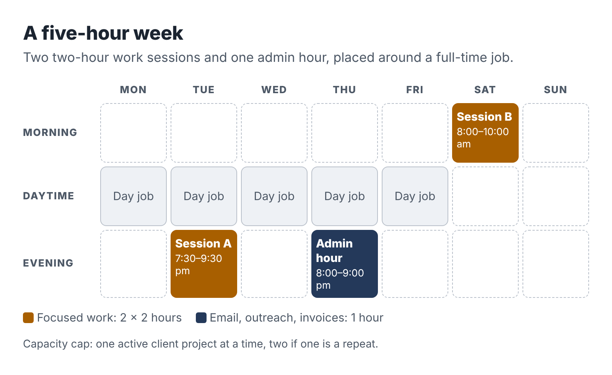

# 2. Find five hours and protect them

Ask people why their side business failed and few will say the idea was bad. They say they ran out of time. More precisely, they ran out of the right kind of time. They had scraps: twenty minutes on a train, half an hour after the children were asleep, a Saturday morning that kept getting taken by errands. Scraps are fine for answering an email. They are hopeless for deep work like drafting a process manual or testing an automation, because by the time you have reloaded the problem into your head the scrap is gone.

So the first piece of building is a calendar, not a website or a logo.

## The five-hour week

The default schedule in this book has three blocks:

- Session A: two hours of focused work, for example Tuesday 7:30 to 9:30 p.m.
- Session B: two hours of focused work, for example Saturday 8:00 to 10:00 a.m.
- The admin hour: one hour for email, invoices, outreach messages and planning, for example Thursday 8:00 to 9:00 p.m.

That is five hours. It is small enough to keep for months beside a full-time job and large enough to deliver a real piece of work every two or three weeks.

Why two-hour sessions? Because most of the work in a service business has a warm-up cost. Opening the files, reading your notes, remembering where you stopped and what the client said: that takes fifteen to twenty minutes. In a one-hour session you lose a third of the time to warming up. In a two-hour session you lose a sixth. Longer than two and a half hours, most people find their attention fading after a full workday, and errors creep in. Two hours is a good compromise for evenings and early weekend mornings.

Why a separate admin hour? Because admin expands to fill whatever space you give it. If you let email into your work sessions, you will spend them answering email. Corralling it into one hour protects the sessions where the paid work happens and gives you a fixed time to chase leads, send invoices and reply to clients, which they will appreciate more than you might expect.

## Pick your hours from evidence

Before you decide when your sessions go, look at last week. Take a sheet of paper or open a spreadsheet and mark, hour by hour, what you actually did from waking to sleep on each of the seven days. Be honest about the time that went to scrolling or television; you are not judging yourself, you are looking for room.

Most people find their five hours in one of four places:

1. Early mornings. Getting up an hour earlier two or three days a week gives you the freshest hours of your day. It works best for people whose job drains them mentally by evening.
2. One weekday evening plus one weekend morning. The most common pattern. The weekend session is often the most productive of the week.
3. A lunch break used for admin. If your employer allows it and you use your own phone or laptop off the company network, a lunch break can absorb the admin hour. Read Chapter 3 before you do this.
4. Recovered time. Commutes that are now shorter, a standing social commitment you stopped enjoying long ago, an hour of television you would not miss.

Then look at your energy. A two-hour session at 10 p.m. after a hard day is worth less than a two-hour session at 7 a.m. after sleep. Schedule your deep work for the hours when you think well and put admin in the tired slots.

## The capacity cap

Five hours a week is about twenty hours a month. Here is a rough way to think about what that buys you, using the kinds of projects in this book:

| Item | Hours a month |
|---|---|
| Delivering one small project | 8–12 |
| Finding clients and writing proposals | 4–6 |
| Admin, invoicing, bookkeeping | 2–3 |
| Learning and improving the offer | 1–2 |

Add that up and one active project at a time is roughly your capacity. Two small projects in a month is possible if one is a repeat of something you have done before. Three is not.

So write down a rule now, before the first enquiry arrives: *I will have at most one active client project at a time, two if one is a repeat.* When a third person wants to buy, you offer a start date. "I can begin on the 14th" is a perfectly professional sentence, and a waiting list does your reputation no harm.

This cap feels uncomfortable at first because it seems to leave money on the table. It does, a little. It also keeps you from delivering three projects badly, making mistakes at your day job because you were up until one in the morning, and quitting in month four. The cap is what lets you keep going long enough for the business to grow.

## Pause triggers

Your job will have heavy seasons: quarter-end, an audit, a product launch, a reorganization. Your life will have them too: a new baby, an illness, exams, a move. Decide now what happens to the business when they arrive.

Write two or three pause triggers. For example:

- If my day job requires more than 50 hours in a week, I cancel that week's sessions and tell any active client their delivery moves by one week.
- If I sleep less than six hours on three nights in a row, I take the next week off the business.
- If my manager raises any concern about my focus or performance, I pause new sales for a month and look hard at what changed.

Build in the promise to clients from the start. In your proposals, delivery dates are set in working sessions with a small buffer, and you tell clients you run the business alongside a full-time role. Most small business owners respect that; many of them started the same way. What they will not respect is silence and a missed deadline.

## Make the sessions stick

A schedule on paper is a wish. A few habits turn it into something you actually do.

### Decide the when, where and what in advance

Psychologists call this an implementation intention: a plan in the form "When it is Tuesday at 7:30, I will sit at the kitchen table and draft section two of the client's manual." In a 2006 review of 94 studies, Peter Gollwitzer and Paschal Sheeran found that people who wrote plans in this if-then form reached their goals noticeably more often than people who only set the goal; across the studies the effect was medium to large (an effect size of 0.65). The detail matters. "Work on the business this week" is a goal. "Tuesday, 7:30, kitchen table, section two" is a plan.

### End every session by writing the next first step

One line at the bottom of your notes: "Next: check the three pricing figures in the vendor brief against the vendors' own pages." It takes thirty seconds and saves you most of the warm-up next time.

### Use a session ritual

The same drink, the same playlist, the same chair. It sounds trivial. It tells your brain the workday is over and this is something else.

### Keep work and business on different machines

That is a legal and ethical matter, covered in the next chapter. It is also practical. When your business lives on a separate laptop or at least a separate user account, opening it is a clear switch, and you are never tempted to "just quickly check" the work inbox in the middle of a session.

## The conversation at home

If you live with a partner, family or housemates, they are investing in your business too, because some of your five hours will come from time you would have spent with them. Talk to them before you start. Say what the hours are, what you hope the business will do (pay off the car, build a fund, test whether you could go independent one day) and how long the experiment lasts. Ten weeks is easier to agree to than "indefinitely."

Then hold up your end. When the session ends, close the laptop. The point of a cap is that the business has edges. People who live with someone who works "a bit" every night, with no edges, tend to stop supporting the project. People who see a calendar with clear blocks, and a business that gives something back, tend to become its biggest fans.

## What if you have fewer than five hours?

Some readers have caring duties, long commutes or second jobs already. If you can find only two or three hours a week, the plan in this book still works; it just runs at half speed. Keep one two-hour session for work and fold admin into fifteen-minute pockets during the week, using your phone. Choose an offer from Chapter 5 with a short delivery time (a research brief or a small cleanup job; an automation build takes too long), keep the cap at one client and double every timeline in the six-week plan.

What does not work is trying to run a five-hour plan on two hours. That is how people end up with a half-finished project, an annoyed client and the conclusion that "side businesses don't work for people like me." They do. They just have to be sized to the time you really have.

::: session
## Your next session

1. Log last week, hour by hour, and circle the slots you could reclaim.
2. Put Session A, Session B and the admin hour in your calendar as recurring events for the next ten weeks.
3. Write your capacity cap and two pause triggers on one page and keep it where you will see it.
4. Have the conversation at home.
:::
