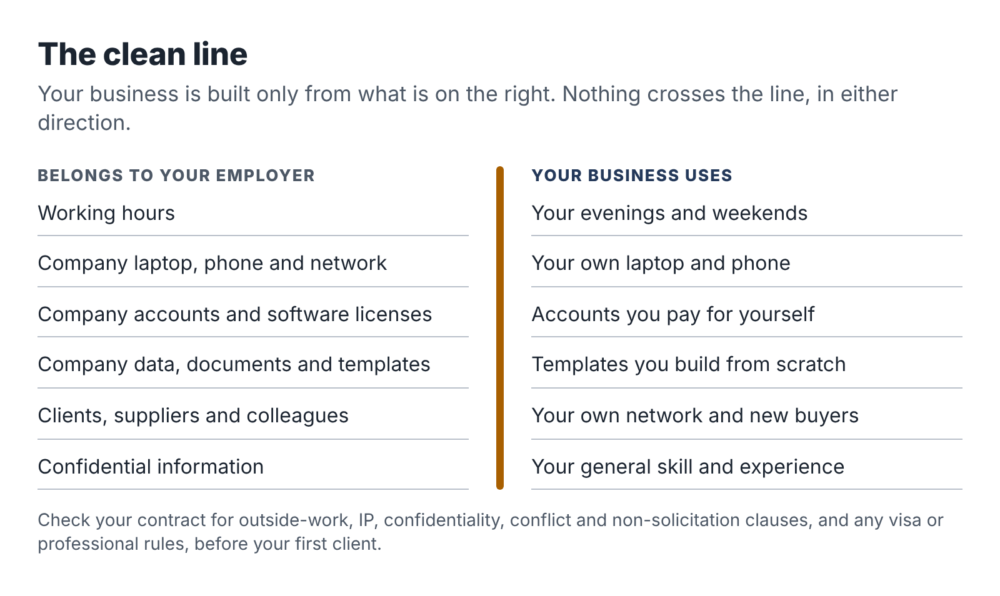

# 3. Your employer, your contract and the clean line

Mei was a data analyst at an insurance broker. On weekends she started building simple reporting dashboards for two local businesses, a gym and a café group. She was good at it, the clients were delighted, and within three months she had a waiting list.

Then her manager asked to see her. The company's IT team had noticed a personal cloud-storage folder synced to her work laptop, and in it were files with the café group's sales data. Nobody accused her of stealing anything; the files were her side clients' data, not the broker's. But she had broken two policies at once, one on personal software and one on outside work, which her contract said needed written approval. She had also, without meaning to, put a third party's financial data on a device her employer controlled. The conversation ended with a formal warning and an instruction to stop the side work until HR had reviewed it.

Mei kept her job, and after a few awkward weeks she got the approval. But she had come close to losing a good career over a business that was earning her a few hundred dollars a month, and the cause was entirely avoidable.

This chapter is about avoiding it. It is the least exciting chapter in the book and possibly the most important.

## Why this matters more than it seems

Your job is the asset that pays for everything else, including the time to build this business. A side business that puts your job at risk is a terrible trade even if it is going well. And the risks are not usually dramatic. They come from small, ordinary things: using the work laptop because it is faster, mentioning a client's name in a LinkedIn post, picking up a freelance job from a company that turns out to be your employer's supplier, pasting a work template into a chatbot to adapt it for a side client.

The goal is a clean line. On one side is everything that belongs to your employer: its time, equipment, accounts, software licenses, data, confidential information, clients, suppliers and the work product you create for it. On the other side is your business, built from your own time, your own equipment, your own accounts and your general skills and knowledge. Nothing crosses the line.

## Read your contract, then your handbook

Most people have not read their employment contract since the day they signed it. Find it now, along with the employee handbook and any policies on outside work, conflicts of interest, confidentiality, IT use and AI use. Read them with a pen. You are looking for six kinds of clause.

### 1. Outside work or moonlighting

Some contracts say nothing about outside work. Some require you to tell your employer. Some require written approval. A few prohibit it entirely, or prohibit it in the same industry. Civil servants and public-sector employees often have specific rules. If your contract requires approval, you need it before you take a paid client, not after.

### 2. Intellectual property and inventions

Many contracts say the employer owns anything you create "in the course of employment." Some go much further and claim anything you create while employed that relates to the employer's business, or even anything at all. How far those clauses can reach depends on where you live. In the United States, several states limit them by law. California's Labor Code section 2870 is the best known: it says an employer generally cannot claim an invention you developed entirely on your own time without using its equipment, supplies, facilities or trade secrets, unless the invention relates to the employer's business or research or results from work you did for the employer. Delaware, Illinois, Kansas, Minnesota, North Carolina and Washington have similar laws, Nevada and Utah have their own variants, and New York added a limit in 2023. Outside the US, the rules vary again.

You do not need to become an expert in this. You need to notice whether your contract has a broad IP clause and, if it does, make sure your side service is clearly unrelated to your employer's business and built entirely on your own time and equipment. If in doubt, ask an employment lawyer for a one-hour review. It is one of the best uses of a few hundred dollars you will find.

### 3. Confidentiality

You will almost certainly have agreed to keep your employer's confidential information confidential, during and after your employment. That includes things you might not think of as secret: internal templates, pricing, client lists, process documents, the structure of a report, the name of a supplier. Your general skill at writing procedures is yours. The procedure template your team uses is not.

### 4. Conflicts of interest

A conflict exists when your side business could compete with your employer, serve its competitors, sell to it, buy from it or otherwise give you a reason to act against its interests. Many handbooks require you to disclose any potential conflict, even a small one.

### 5. Non-solicitation and non-competition

Non-solicitation clauses stop you from approaching your employer's clients, suppliers or staff. They are common and generally enforced. Non-compete clauses restrict working for competitors or in the same field, during or after employment. In the US, a 2024 federal rule that would have banned most non-competes was struck down by a court, and in September 2025 the Federal Trade Commission dropped its appeal, so enforceability is back to being decided state by state. California, for example, voids most non-competes; other states enforce reasonable ones. During your employment, a duty of loyalty usually applies whether or not a non-compete exists: you cannot compete with your current employer while it pays you.

### 6. IT, devices and AI use

Look for policies on using company equipment for personal purposes, installing software, using personal cloud storage and using AI tools. Many companies now have an AI policy. Even if it only governs work tasks, read it, because it tells you how your employer thinks about data in AI tools and what would alarm them.

## Special situations

Some readers face rules that go beyond their contract. Check these before anything else.

*Work visas.* In many countries your right to work is tied to a specific employer or type of work. In the United States, H-1B status generally authorizes work only for the sponsoring employer, and immigration lawyers commonly advise that freelancing or self-employment on the side is unauthorized employment that can put your status at risk. In the United Kingdom, Skilled Worker visa holders can do some supplementary work, but the rules on hours, occupations and self-employment are specific and have changed several times. If you are on any work visa, speak to an immigration adviser before you earn a single dollar from side work. This is not a place to guess.

*Regulated professions.* Financial services employees in the US who are registered with FINRA must give their firm written notice before starting an outside business activity under FINRA Rule 3270, whether or not they are paid. Lawyers, accountants, healthcare workers, teachers and public officials often have professional codes that govern outside work and conflicts. The same applies in many other countries.

*Government and public-sector roles.* Public servants often face rules on outside employment, use of official information, and serving clients who deal with their agency. These rules can be strict and can apply even to unpaid work.

*Security clearances.* If you hold a clearance, outside business activity and foreign clients may need to be reported.

None of this means you cannot have a side business. It means that the order of operations is: check the rules, get permission if needed, then sell.

## Choosing an offer that stays clear of conflict

The easiest way to stay on the right side of the line is to choose a side business that sits in a different market from your employer. Ravi, the procurement analyst you met in the introduction, is a good example.

Ravi's day job is comparing suppliers for a university: lab equipment, cleaning contracts, software. His obvious side offer was "procurement advice," but that would have put him in the same market as his employer's suppliers, some of whom might happily pay for an insider's view of how universities buy. That is precisely the kind of conflict that ends careers.

So Ravi drew three boundaries. He would not work for any company that sells to universities or colleges. He would not work for any other university. And he would only use public information: vendor websites, published pricing, public reviews and documentation, never anything he had seen in a tender at work. Within those boundaries he found a clean market: small nonprofits choosing software for donors, volunteers or bookkeeping. They need exactly the skill he has, they are nowhere near his employer's world, and the information he needs is public. He wrote the boundaries into his offer page so that every client could see them.

You can do the same. Write your own exclusion list: industries, companies and types of client you will not take on. It protects you, and it reassures your employer if you ever need to explain your business.

## To tell or not to tell

If your contract requires disclosure or approval, the question is settled: tell them, in writing, before you start. If your contract is silent, you have a choice.

There is a good case for telling your manager anyway, especially if your business is clearly separate from your employer's. Disclosure on your own terms is far better than discovery. A manager who learns about your side business from a LinkedIn post or a colleague will wonder what else you have not mentioned. A manager who hears about it from you, framed properly, usually shrugs.

The framing matters. Lead with the job. Something like this:

> "I wanted to let you know about something I'm doing outside work, so there are no surprises. On a couple of evenings a week I'm doing small documentation projects for local trade businesses: plumbers, electricians, that kind of thing. It has no overlap with our clients or suppliers, I do it entirely on my own equipment and time, and it won't affect my hours or availability here. If the company has a policy or form for this, I'm happy to complete it."

Then send a short email confirming the conversation, so there is a record.

What if your manager says no? Then you have a decision to make, but at least you are making it with full information. Sometimes "no" means "not in this form," and a different offer or a narrower client list would be acceptable. Sometimes it means the job and the business are not compatible, and you will have to choose. Either way, you have not built a business on a foundation that could collapse at any moment.

## Building the clean line in practice

Set all of this up before your first client.

- A separate device or user account. Ideally a personal laptop. At minimum, a separate user profile on a personal machine. Never the work laptop, not even "just for email."
- Separate accounts. A business email address on your own domain or a free provider, separate AI tool accounts paid with your own card, your own cloud storage and your own calendar.
- No work materials. Do not copy templates, checklists, slide decks or documents from work, even if you wrote them. Build your own from scratch. They will be better, because you will be designing them for your new clients.
- No work time. Business calls, emails and work sessions happen outside your working hours. If you take a client call at lunch, use your own phone, off the company network, and keep it short. Many people find it simpler to avoid business activity during working hours entirely.
- No work contacts as prospects. Your employer's clients, suppliers and staff are off-limits as buyers unless your employer has explicitly agreed.
- Careful public profiles. If you promote your service on LinkedIn, make sure it is consistent with whatever you have disclosed at work. Many people promote their side business under a simple business name and keep their personal profile focused on the day job.

::: box
### Employer boundary checklist

Answer each question with yes, no or not sure. Any "not sure" is a reason to look closer or ask for advice.

1. I have read my contract, handbook and policies on outside work, conflicts, confidentiality, IT and AI.
2. My contract does not require approval for outside work, or I have obtained written approval.
3. My side offer does not compete with my employer or serve its competitors, clients or suppliers.
4. My offer is unrelated to my employer's business, so a broad IP clause does not reach it, or I have taken advice.
5. My work visa or professional rules permit this activity, or I have confirmed with an adviser.
6. I will use only my own devices, accounts, software and time.
7. I will not use any employer template, document, data or confidential information.
8. I have written an exclusion list of clients and industries I will not serve.
9. I have decided whether to disclose and, if so, how and when.
10. My public profiles are consistent with what my employer knows.

A full copy is in the Toolkit at the back.
:::

::: session
## Your next session

1. Find and read your contract, handbook and the relevant policies. Mark the six kinds of clause.
2. Complete the employer boundary checklist. Book a short consultation with an employment or immigration lawyer for any "not sure" that matters.
3. Write your exclusion list.
4. Set up the separate device or user account, business email and storage.
:::
