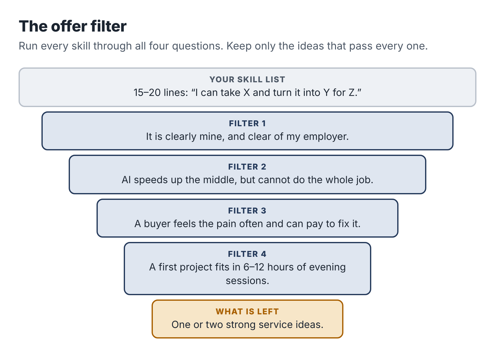

# 4. The skill you already sell every day

When people decide to start a side business, they often look outward first. What is popular? What are other people selling? What did that person on social media say made them money? It is the wrong direction. The best evening business for an employed person usually starts with a much plainer question: *what do people at work keep asking me to do?*

## The Tuesday task

Think about an ordinary Tuesday at work. Somewhere in that day there is probably a task that goes to you because you do it well and others would rather not. It is often unglamorous. It might be:

- turning a messy meeting into clear notes and action items;
- writing the step-by-step instructions for a process so a new hire can follow them;
- cleaning up a spreadsheet so the numbers actually add up and a manager can read it;
- comparing three suppliers or tools and recommending one;
- setting up a form, a workflow or an automated email in a system nobody else understands;
- rewriting a dense policy into something staff will read;
- building a training deck from a pile of old materials;
- answering the same customer questions and turning them into an FAQ.

That is your Tuesday task. It has three properties that make it a strong foundation for a service. It is repeatable, so you can deliver it more than once without reinventing it. It is mostly document- or data-shaped, so AI tools can speed up the middle of it. And you do it well enough that people come to you for it, so you can judge whether an AI draft is good, which, as Chapter 1 showed, is where the money is.

## Make your skill inventory

Take the list from your Chapter 1 session and widen it. Over the next week, keep a note on your phone of every task where someone relies on you. Then add tasks from earlier jobs, volunteer roles, hobbies and side projects. Aim for fifteen to twenty items.

For each one, write a sentence in this form:

> I can take *[messy input]* and turn it into *[useful output]* for *[kind of person]*.

For example:

- I can take a recorded walkthrough of how someone does a job and turn it into a written procedure a new employee can follow.
- I can take a pile of supplier websites and price lists and turn it into a one-page comparison with a recommendation.
- I can take a contact form and an inbox and turn them into a system that answers enquiries the same day.
- I can take a year of messy sales spreadsheets and turn them into a monthly summary a busy owner understands.
- I can take a long, dense document and turn it into a short version the right audience will actually read.

The "messy input to useful output" shape matters. It forces you to name what the client hands over and what they get back. Vague skills ("I'm good at communication," "I know Excel") become sellable once they take this shape.

## Run each idea through four filters

Now test each line against four filters. Be strict. You are looking for one or two that pass all four, not ten that pass most.

### Filter 1: Is it clearly yours, and clear of your employer?

Can you do this to a professional standard without your employer's templates, data, tools or colleagues? And can you sell it to people who are not your employer's competitors, clients or suppliers? Use the exclusion list from Chapter 3. If a skill only works inside your employer's systems (a proprietary software tool, an internal database), it may not travel.

### Filter 2: Does AI speed up the middle without replacing the whole?

Picture the work in three stages: gathering the inputs, doing the transformation, checking and fitting the result. AI should make the middle stage faster: transcribing, sorting, drafting, comparing, reformatting. The first and last stages should still need you. Apply the one-sentence test from Chapter 1. If a client could get 80 percent of the result by typing a sentence into a chatbot, drop the idea or look for a narrower version where your judgment does more of the work.

### Filter 3: Does someone feel the pain and have money to fix it?

A service needs a buyer who notices the problem, feels it often and can pay. Small business owners, nonprofit managers, independent professionals and team leads in small companies are good buyers for evening services: they lack staff for this kind of work, they make decisions quickly, and they are used to paying freelancers. Large corporations are hard: long procurement, legal reviews, and often policies against engaging individuals. Consumers are hard too, because they are price-sensitive and the work is often emotional.

Ask: who loses time or money every month because this task is not done well? Can I name ten of them?

### Filter 4: Can it be delivered in a few evening sessions?

The first project should take between six and twelve hours of your time, including talking to the client. That rules out anything that needs daytime availability (live customer support, same-day turnaround, on-site visits during business hours), anything with a long, uncertain build (a full custom software project), and anything that is never really finished (ongoing social media management, for instance, which creates daily obligations).

## Three examples

The three people you are following each went from a skill to an idea in a different way.

Dana, the operations coordinator, listed sixteen skills. Several failed filter 1 because they were tied to her company's warehouse software. "Report writing" failed filter 2 because it was too generic. But one line passed everything: "I can take a recorded walkthrough of how someone does a job and turn it into a written procedure a new employee can follow." She had done exactly this for forty warehouse processes. It was clearly hers, AI could transcribe and draft from a recording, and the checking needed her eye for missing steps and safety points. The buyer took some thought. Her employer's world was logistics, so she ruled that out. She landed on small trade businesses, plumbing, electrical, cleaning and HVAC firms with five to thirty staff, whose owners carry every process in their heads and lose hours training each new hire.

Ravi, the procurement analyst, started with "supplier comparison," then narrowed it to fit his conflict boundaries. His idea: dated, sourced comparison briefs to help small nonprofits choose software. The work is document-heavy, AI can gather and sort public information quickly, and his value is in knowing what questions to ask, which claims to check and how to write a recommendation a board will accept.

Teresa, the CRM administrator, listed automation skills she uses daily: forms, routing, templates, email sequences. Her employer sells software to mid-sized companies, so she chose a market far away: independent wedding and portrait photographers. Many of them lose bookings because they reply to enquiries a day or two late, while they are out shooting. Her idea: set up a simple system that captures each enquiry, drafts a personal reply with AI and sends it only after the photographer approves it on their phone.

None of these ideas is glamorous. All three solve a real problem, for a buyer who can pay, with a skill the seller has practiced for years. That combination is what you are looking for.

## What if nothing passes?

Sometimes a skill inventory produces nothing that passes all four filters. Usually one of three things is going on.

Your list may be too abstract. "Project management" fails; "turning a messy project into a one-page plan with owners and dates for a small team" might pass. Push each line into the messy-input-to-useful-output shape until it is concrete.

Your buyer may be wrong. A skill that fails filter 3 for big companies may pass for small ones, or for a specific trade or profession. Try three different buyers for each skill before you give up on it.

Or your strongest skills may genuinely be tied to your employer, which is common for people with long tenure in specialized roles. In that case, look at earlier jobs, volunteer work and serious hobbies. A former teacher now working in insurance might still be very good at turning dense material into lessons. A bookkeeper for a church might be the perfect person to help small charities clean up their records.

If you still have nothing, Chapter 5 lists twelve service types that work well for employed people. Read them as prompts, not prescriptions. The best version of each one will be the version that draws on what you already know.

::: session
## Your next session

1. Complete your skill inventory: fifteen to twenty lines in the "I can take X and turn it into Y for Z" form.
2. Run every line through the four filters. Cross out the failures.
3. For the survivors, write down three possible buyers each.
4. Choose your top two ideas. Don't pick one yet; Chapter 5 may change your mind.
:::
