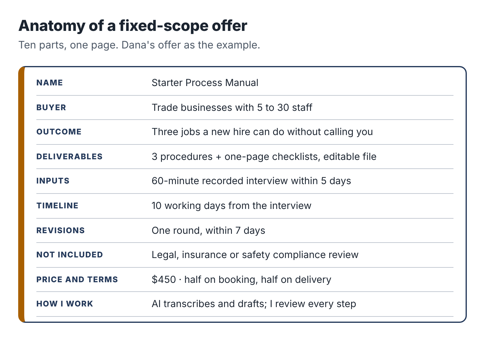

# 6. Package it: the fixed-scope offer

Here is how most new freelancers describe what they do: "I help small businesses with documentation, processes and operations, using AI to work faster and smarter. Get in touch to discuss your needs!"

Here is how Dana described hers, after one evening's work:

> **The Starter Process Manual.** For trade businesses with 5 to 30 staff. I interview you for 60 minutes, by video, about three jobs your team does every week. Within 10 days you receive three written procedures (steps, checks, who does what, and a one-page checklist for each) as an editable document. One round of revisions is included. $450.

The first description is about the seller. The second is about the buyer and what happens to them. The first invites a long conversation about "needs" that will take three of your precious evening hours and may never lead anywhere. The second lets a plumbing firm's owner decide in about a minute whether they want it.

That second description is a fixed-scope offer, sometimes called a productized service. It is the single most useful tool for running a service business on limited hours, and this chapter shows you how to build one.

## Why fixed scope fits an evening business

A fixed-scope offer has a defined outcome, defined inputs, a defined timeline, a defined price and defined limits. It helps you in five ways.

It is easy to buy. Buyers dislike uncertainty about cost and outcome. A clear offer removes both.

It protects your time. When the scope is written down, "Could you also..." has an obvious answer: "Yes, that would be an addition. Here's what it costs."

It lets you get faster. Doing the same kind of work repeatedly, with the same templates and prompts, makes every project quicker than the last. Your effective hourly rate rises without raising your price.

It makes pricing simpler. You price the outcome, not your hours, so the client is not watching a timer and you are not penalized for getting faster.

And it makes AI use straightforward to explain. The client is buying a defined result to a defined standard. How you produce it, as long as you are honest about your process and protect their data, is your business.

## The anatomy of an offer

Every fixed-scope offer has the same parts. Write each one down.

### A name

Give the offer a plain, descriptive name: "Starter Process Manual," "Software Decision Brief," "Enquiry Autopilot Setup." Clever names make people work to understand them. Descriptive names sell.

### The buyer

Name the specific kind of client: "trade businesses with 5 to 30 staff," "nonprofits with fewer than ten staff choosing donor or volunteer software," "independent wedding and portrait photographers." Narrow feels risky, but it helps buyers recognize themselves, and it lets you build examples and language that fit them exactly.

### The outcome

What does the client have when you're done, and why does it matter to them? "Three procedures your newest employee can follow without calling you." "A recommendation you can take to your board, with every claim sourced." "Every enquiry answered within two hours, even when you're on a shoot."

### The deliverables

List exactly what the client receives, in what format. "Three procedures, each with numbered steps, quality checks, owner and a one-page checklist, delivered as an editable Google Doc or Word file."

### The inputs

What do you need from the client, and by when? "A 60-minute recorded video interview within five days of booking." "The names of up to four options you are considering and your three most important requirements." "Admin access to your enquiry form and email, and 30 minutes for a handover call." Write this down, because missing inputs are the most common reason small projects stall.

### The timeline

When will they receive it? Count in your sessions, not calendar days, and add a buffer. If a project needs four two-hour sessions and you have two a week, that is two weeks of work. Promise ten working days from receiving all the inputs, not from booking.

### The revisions

How many rounds of changes are included, and what counts as a revision? "One round of revisions, requested within seven days of delivery, covering corrections and adjustments to the delivered procedures. New procedures are a new project." Without this line, revisions can double your hours before you notice.

### The exclusions

What is not included? "Does not include legal or safety compliance review." "Covers public information only; does not include vendor negotiations or contract review." "Does not include payment processing or integration with accounting software." Exclusions save arguments later and show the client you have thought about their situation.

### The price and terms

A single price for the defined scope, plus how and when they pay. For a first pilot, many service providers ask for 50 percent on booking and 50 percent on delivery. Chapter 13 shows how to set the number.

### The process and tools note

One or two sentences on how you work and how you handle their information. "I use AI tools to transcribe the interview and produce first drafts, then review and edit every procedure myself. Your recording and documents are stored in a private folder and deleted 30 days after the project ends unless you ask me to keep them." Chapter 14 covers this in detail.

## The three offer cards

Here are the finished offers for the three people you are following. Notice how specific they are.

::: box
### Starter Process Manual (Dana)

For: trade and service businesses with 5 to 30 staff.

Outcome: three of your most common jobs written down so a new team member can follow them without calling you.

You receive: three procedures, each with numbered steps, quality checks, who is responsible and a one-page checklist, as an editable document.

I need from you: a 60-minute recorded video call where you walk me through the three jobs, within 5 days of booking, plus one 20-minute review call after the first draft.

Timeline: delivered within 10 working days of the interview.

Revisions: one round, within 7 days of delivery.

Not included: legal, insurance or health-and-safety compliance review; procedures beyond the three agreed.

Price: $450. Half on booking, half on delivery.

How I work: AI tools transcribe the interview and produce a first draft. I review, rewrite and check every step myself. Your recording is deleted 30 days after delivery.
:::

::: box
### Software Decision Brief (Ravi)

For: nonprofits with fewer than ten staff choosing donor management, volunteer or bookkeeping software.

Outcome: a clear recommendation you can take to your board or trustees, with every fact sourced and dated.

You receive: a 6 to 10 page brief comparing up to four products against your top requirements, with a summary table, costs for your size, risks, a recommendation and a source list.

I need from you: a 45-minute call about how you work today and what matters most, plus any shortlist you already have.

Timeline: delivered within 10 working days of the call.

Revisions: one round of questions and clarifications.

Not included: vendor negotiations, contract or legal review, data migration. I use public information only and do not accept payment or commission from any vendor. I do not work for companies that sell to universities.

Price: $600. Half on booking, half on delivery.
:::

::: box
### Enquiry Autopilot Setup (Teresa)

For: independent wedding and portrait photographers.

Outcome: every enquiry gets a warm, personal reply within two hours, even when you're shooting, and nothing goes out without your approval.

You receive: a connected enquiry form, an enquiry log, AI-drafted replies in your voice sent to your phone for one-tap approval, a manual fallback and a one-page guide. Built in your own accounts.

I need from you: 45 minutes to talk through how you handle enquiries now, five past replies you liked, your packages and prices, and admin access to your form and email for the setup period.

Timeline: live within 10 working days of receiving access.

Revisions: two weeks of adjustments after launch.

Not included: website redesign, payment or contract systems, ongoing maintenance (available separately at $40 a month).

Price: $750. Half on booking, half at launch.
:::

## Testing your offer before anyone buys

Before you take the offer to anyone, test it three ways.

*The one-minute test.* Show the offer card to a friend who knows nothing about your field. Give them one minute. Ask them who it is for, what the buyer gets and what it costs. If they can't answer all three, simplify.

*The "what if" test.* List the five most likely ways a project could go wrong: the client misses the interview, sends the wrong files, wants extra procedures, disputes the quality, doesn't pay the second half. Check that your offer card already handles each one, or add a line that does.

*The time test.* Walk through the project in your head, session by session. Write down what you would do in each two-hour block. If it takes more than six sessions (twelve hours) including the client calls, cut the scope. Your first project will take longer than you think; leave room for that.

## A sample is worth a thousand words

Before your first conversation with a buyer, make a sample of the deliverable. Not real client work, which you don't have yet, but a realistic example built from invented or public material.

Dana wrote a sample procedure for "Replacing a kitchen tap" by recording herself interviewing a friend who is a plumber (with his permission) and turning it into a finished procedure and checklist. Ravi wrote a short sample brief comparing three free volunteer-scheduling tools for a fictional animal shelter, using only public information. Teresa built a demo enquiry form for a made-up photographer and recorded a two-minute screen video of an enquiry arriving and a draft reply appearing on her phone.

Samples do three things. They prove you can deliver. They show buyers exactly what they are getting, which is far more persuasive than any description. And they force you to do the work once, end to end, before a client is waiting, which shows you where your process breaks and how long it really takes.

Make your sample now, in your next session or two. You will use it constantly in Part Four.

::: session
## Your next session

1. Write your offer card using the anatomy above. Keep it to one page.
2. Run the one-minute, "what if" and time tests, and revise.
3. Plan your sample deliverable: what invented or public material you will use and who might help.
:::
