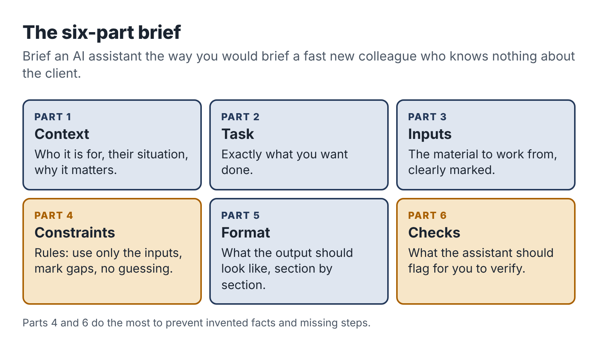

# 7. A small tool kit, kept separate

There is a version of this chapter that lists sixty AI tools with screenshots. It would be out of date before the book reached you, and it would encourage the most common mistake new AI-assisted freelancers make: spending their first month collecting tools instead of clients.

So this chapter does something more durable. It describes the five kinds of tool you need, what to look for in each, and how to set them up so that your business data stays separate and safe. Then it teaches the one skill that matters more than any particular tool: how to brief an AI assistant so you get usable work out of it.

## The five tools you need

### 1. A general AI assistant on a paid plan

This is your main workhorse: a chat-based assistant such as ChatGPT, Claude, Gemini or Microsoft Copilot. You will use it to draft, summarize, compare, restructure, explain, check and reformat.

Pay for it. Paid plans for individuals have typically cost around $20 a month. A paid plan gives you better models, larger limits on how much text you can work with, file uploads, and usually stronger controls over your data. For a business that handles client material, those controls matter more than anything else.

Before you put any client material into an assistant, open its settings and its privacy terms and find the answers to three questions:

1. Is my content used to train the provider's models? Many consumer plans use conversations for training unless you switch it off; business and team plans usually do not by default. Find the setting and choose the option that keeps client content out of training.
2. How long is my content kept, and can I delete it? Know the retention period and how to delete conversations and files.
3. Who at the provider can see my content, and when? Most providers keep the right to review content for safety or abuse. Read what they say.

Write the answers down in a one-page "data note" for your business. You will use it in proposals and when clients ask. If the answers change (providers update their terms often), update your note.

One assistant is enough to start. Some people keep a second as a cross-check for research work: asking a different model the same factual question is a cheap way to spot claims that need checking.

### 2. Transcription

If your service involves interviews, walkthroughs or meetings, you need a reliable transcription tool. Options include standalone transcription services, meeting recorders and the built-in transcription in video-call software. Many AI assistants can also transcribe an uploaded recording.

Look for accuracy with accents and technical vocabulary, speaker labels, timestamps, easy export and clear deletion controls. Always tell people they are being recorded and get their agreement before you press record.

### 3. Documents, storage and sharing

You need somewhere to write deliverables and share them with clients: a personal Google Workspace or Microsoft 365 account, or similar. Create a folder for each client with a consistent structure:

```
ClientName-Project
  01-inputs
  02-working
  03-delivered
  project-log
```

Keep originals in `01-inputs`, drafts in `02-working`, final versions in `03-delivered`, and your notes, time log and decisions in `project-log`. At the end of the project, follow the deletion promise in your offer.

### 4. Automation (if your service needs it)

If you build workflows, you need a no-code automation platform such as Zapier, Make or n8n, plus a basic understanding of the forms, spreadsheets and email tools your clients use. For your own business, automation is a later concern. Don't automate your own admin until you have done it by hand enough times to know what it should do.

### 5. Invoicing and payments

You need a way to send professional invoices and receive payment: an invoicing feature in accounting software, a payment provider, or a simple invoice template plus bank transfer. Chapter 15 covers this with the rest of the money setup.

That is the whole kit. For most services, the monthly cost is between $20 and $60.

## Keep it separate

Everything in this kit must be yours: paid with your own card, registered to your business email, installed on your own device. The reasons are in Chapter 3, but it is worth adding one practical point.

Many employers now monitor what software is used on their devices and networks, and many have AI policies that restrict which tools can be used and for what. Even an innocent use of your personal AI account on a work laptop can look, to an IT team, like an employee pasting company data into an unapproved tool. Samsung's response in 2023, after engineers pasted internal source code into a public chatbot, was to ban generative AI tools on company devices altogether. You never want your side business to be the reason your employer's IT team opens a file on you.

## Briefing an assistant: the six-part brief

The difference between people who find AI assistants useful and people who find them useless is mostly in how they ask. A one-line request gets a generic answer. A proper brief gets work you can use.

Think of the assistant as a fast, well-read new colleague who knows nothing about your client, your standards or your goal. You would not hand that colleague a one-line note and expect a finished deliverable. You would brief them. The six-part brief below works with any capable assistant.



1. Context. Who the work is for, why it matters, what situation they're in. "The client is a plumbing company with 12 staff. The owner wants new hires to be able to do a standard boiler service without calling him."
2. Task. Exactly what you want done. "Turn the interview transcript below into a draft standard operating procedure for an annual boiler service."
3. Inputs. The material to work from, clearly marked. "Transcript is between the lines marked START and END."
4. Constraints. The rules. "Use only information in the transcript. Do not add steps that are not mentioned. Where something seems missing or unclear, add a question in square brackets instead of guessing. Write for someone with basic trade training. Use short numbered steps."
5. Format. What the output should look like. "Title, purpose (one sentence), tools and materials, numbered steps grouped into stages, quality checks, and a list of open questions for the owner."
6. Checks. What you want the assistant to verify or flag. "At the end, list any steps where the transcript was ambiguous, and any safety-related points I should confirm with the owner."

Here is the same request as a one-liner and as a brief. The one-liner: "Write an SOP for a boiler service from this transcript." The result will be fluent and generic, padded with steps from the model's general knowledge that this owner never mentioned. Some will be wrong for this business, and you will not easily tell which.

The brief takes two minutes longer to write and comes back as a draft that matches the owner's actual process, with gaps marked for you to fill. That difference is where the rest of your evening goes.

## Build a small prompt library

After your sample project and first client project, you will have a handful of briefs that worked. Save them in a document with a short note on when to use each one. A good library for one service usually has five to eight prompts: one for each stage of the work, plus one or two for checking.

Treat the library as working notes, not a product. Update a brief every time you notice it produced a weak result. Over a few projects, this library is where your speed comes from.

The Toolkit at the back of the book includes starter briefs for each of the three pilots.

## What not to put into any AI tool

Some things should not go into an AI tool at all, whatever the settings say, unless the client has explicitly agreed in writing and you have checked the provider's terms:

- passwords, keys and login details;
- financial account numbers, card details and government ID numbers;
- health information about identifiable people;
- information about children;
- anything the client has marked confidential or asked you not to share;
- personal data about third parties (the client's customers, staff or patients) beyond what the task strictly needs.

When a task needs personal data, minimize it. Replace names with roles or initials, remove contact details, cut irrelevant sections. Dana, for example, asks owners not to name customers in her interviews and removes any names that slip in before she drafts. Teresa's automation only sends the AI the enquiry text itself, not the customer's phone number or email address. Chapter 14 goes further.

## Check what comes out

Every AI tool will, at some point, give you something confidently wrong: a made-up fact, a missing step, a number that doesn't add up, a reference to a source that doesn't exist. This is a normal feature of how these models generate text, not a rare glitch, and it does not go away with better prompting. Your service depends on catching it.

The three pilots in the next chapters each include a checking routine fitted to the work. The general principle is simple: the more a mistake would cost the client, the more carefully you check, and anything factual is checked against a source you have seen yourself.

::: session
## Your next session

1. Choose and pay for one general AI assistant. Find the data settings and write your one-page data note.
2. Set up your business documents and storage with the client folder structure.
3. Write a six-part brief for the first stage of your sample deliverable and try it. Save it as the first entry in your prompt library.
:::
