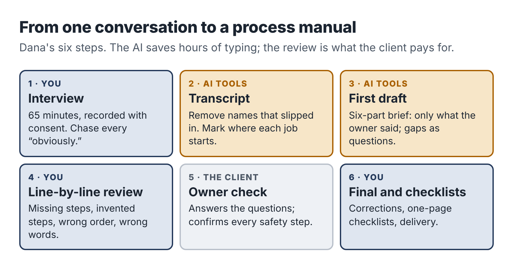

# 8. Pilot one: a process manual from one conversation

Dana's first paying client came from her sample. She showed the "Replacing a kitchen tap" procedure to a former neighbor, Gary, who runs a plumbing and heating firm with fourteen staff. Gary read it standing in his driveway and said, "I've been meaning to do this for six years." He had hired three new engineers that year, and each one had spent their first month phoning him from customer kitchens.

He booked the Starter Process Manual at $450. This chapter follows the project session by session, so you can see how an AI-assisted service actually runs, where the tools help and where Dana had to step in.

## Before the interview: choose the right three jobs

Dana's first move was a short email asking Gary which three jobs cost him the most phone calls from new staff. He listed annual boiler service, unblocking a sink or bath drain, and replacing a radiator valve.

She asked one follow-up question, which turned out to matter: "Is there anything about these jobs where a mistake would be dangerous or expensive?" Gary mentioned gas safety checks on the boiler service and isolating the water properly on the radiator valve. Dana noted both. She is not a plumber and cannot judge whether a gas safety step is correct, so her offer excluded compliance review and she planned to flag these steps clearly for Gary to confirm.

## Session 1 (2 hours): the interview

The interview is the most important hour of the project, and the AI does nothing during it. Dana's job is to get everything out of Gary's head that a new engineer would need.

She used a simple interview guide, built during her sample project:

1. Walk me through the job from the moment the engineer arrives. What do they do first?
2. What do they need to have in the van before they leave?
3. What do experienced people do that new people forget?
4. Where do new people most often go wrong?
5. How do you know the job is done properly? What do you check?
6. What do you tell the customer at the end?
7. What would make you phone the office or stop the job?

For each of the three jobs, she let Gary talk, then went back with the guide to fill gaps. When Gary said "then you just bleed it," she asked, "Pretend I've never done that. What exactly do I do?" When he said "obviously check for leaks," she asked, "Where? With what? For how long?"

The word "obviously" is gold in a process interview. Every time an expert says it, a step a beginner needs is hiding underneath.

The call lasted 65 minutes. She recorded it with Gary's agreement, which she asked for on the recording itself at the start.

## Session 2 (2 hours): transcript and first draft

Dana transcribed the recording, then read through the transcript once, quickly, to remove two customer names Gary had mentioned and to mark where each job started and ended.

Then she briefed her AI assistant, one job at a time, using a brief from her prompt library:

::: prompt
**Context:** I am writing standard operating procedures for a 14-person plumbing and heating company. The readers are newly hired engineers who have basic trade training but do not yet know this company's way of working. The owner wants them to be able to complete common jobs without phoning him.

**Task:** Turn the interview transcript below into a draft procedure for the job "Annual boiler service."

**Inputs:** The transcript is between START and END. It is a conversation between me (Dana) and the owner (Gary).

**Constraints:** Use only information from the transcript. Do not add steps, tools or safety checks from general knowledge. If something seems missing, unclear or contradictory, insert a question in [square brackets] at that point instead of guessing. Write in plain English, in short numbered steps, using "you" for the engineer. Keep the owner's own terms for tools and parts.

**Format:** Title. Purpose (one sentence). Before you leave (tools and parts). Steps, grouped into stages with short headings. Quality checks before you leave. What to tell the customer. When to stop and call the office. Then a separate list called "Questions for Gary."

**Checks:** At the end, list every step that relates to gas, electrical or water safety, quoting the transcript line it came from, so I can confirm it with the owner.

START
*[transcript]*
END
:::

The first draft for the boiler service came back in under a minute. It had 31 steps in six stages, a tool list and nine questions in square brackets. It was well organized and readable.

It also had problems, which is normal and is what the next session is for.

## Session 3 (2 hours): the review that earns the fee

Dana read each draft against the transcript, line by line. This is the slowest part of the project and the part a client is really paying for. She found four kinds of problem.

*Steps that were in the transcript but missing from the draft.* Gary had mentioned, almost in passing, that engineers should photograph the boiler's data plate on arrival because it saves time ordering parts. The draft left it out. Dana added it.

*Steps that were not in the transcript but appeared in the draft.* Despite the instruction, the draft included "check the flue for obstructions using a mirror." Gary had said nothing about a mirror. It may well be good practice, but it was not *this company's* practice, and Dana had no way to judge. She deleted it and added a question for Gary.

*Steps in the wrong order.* The draft put "explain the service to the customer" at the very end. In the transcript, Gary had been clear that engineers should tell the customer at the start roughly how long the visit would take and that the heating would be off. Dana split it into two steps.

*Language a new engineer wouldn't use.* The draft said "ascertain the operational status of the appliance." Gary's engineers say "check it's firing properly." Dana used Gary's words.

She also went through the safety list the assistant had produced. Of the seven safety-related steps, five matched the transcript exactly. One was paraphrased in a way that changed its meaning slightly, and one, the gas tightness check, Gary had described in a single sentence that left a lot unsaid. Dana marked both for Gary with a clear note: *Please check this step carefully. I am not qualified to judge gas safety and have written it exactly as you described it.*

By the end of the session she had three cleaned-up drafts and a list of eleven questions for Gary.

## Session 4 (1 hour plus a 20-minute call): owner review

Dana sent the drafts to Gary with the questions grouped by job and booked a 20-minute call. On the call he answered all eleven questions, corrected the gas tightness step (adding two checks he did automatically and had forgotten to mention) and asked for one change: a line at the top of each procedure saying which van kit the job needed, using the names on the shelves in his workshop.

That request is a small example of something you will see often. The client knows things about their business that no interview fully captures, and the review call is where they surface. Build it into every offer.

## Session 5 (2 hours): finishing, checklists and delivery

Dana made Gary's corrections, then produced the one-page checklists. Here she used the assistant again, asking it to turn each finished procedure into a checklist of no more than fifteen items, keeping the safety steps verbatim. She checked each checklist against its procedure, fixed two items that had been merged in a confusing way, and formatted everything into a clean document with Gary's company name in the header.

She delivered the manual with a short covering email: what was included, how to use the checklists (print them, laminate them, keep a set in each van), a reminder that one round of revisions was available within seven days, and the second invoice.

Gary asked for one small revision, a typo in a part number. He paid the same day.

## What the procedure looked like

Here is a short extract from the finished boiler-service procedure, so you can see the level of detail that makes a manual useful:

::: box
### Annual boiler service: arriving on site (extract)

1. Introduce yourself and show your ID card.
2. Tell the customer the service takes about an hour and that the heating and hot water will be off for most of that time. Ask if that's OK before you start.
3. Ask whether they have noticed any problems: noises, pressure dropping, error codes, radiators not heating.
4. Photograph the boiler's data plate. Upload it to the job in the app before you start work. *(Saves time if you need to order parts.)*
5. Check the pressure gauge and note the reading on the job sheet before you touch anything.

**Stop and call the office if:** you smell gas, the boiler is visibly damaged, there is water leaking from inside the casing, or the customer reports carbon monoxide alarm activations.
:::

Notice what makes this work: concrete actions, the reason given where it isn't obvious, the company's own tools ("the app," "the job sheet") and a clear stop rule. None of that came from the AI's general knowledge. It came from Gary, through Dana.

## The time log

Dana logged every minute of the project, including the time it took to win the client.

| Activity | Hours |
|---|---|
| Finding the client (sample, conversation, follow-ups) | 2.5 |
| Proposal, booking and invoice | 0.5 |
| Interview prep and interview | 1.5 |
| Transcript cleanup and AI drafts | 1.5 |
| Line-by-line review | 2.5 |
| Owner review call and corrections | 1.0 |
| Checklists, formatting, delivery | 1.5 |
| **Total** | **11.0** |

Her direct costs were $30: a share of her AI subscription and transcription for the month. So the project paid $420 for 11 hours, or about $38 an hour before tax.

That is not a spectacular number. It is a first project, and it included 2.5 hours of finding the client and about an hour of building things (the interview guide, the checklist format) that she will reuse. On her third project, a repeat booking from Gary with her templates in place, she spent 8 hours in total. Chapter 16 shows how those numbers changed over her first five projects.

## What Dana learned

She wrote three notes in her project log after the first project.

*The interview is the product.* The AI saved her perhaps three hours of typing and structuring. But the quality of the manual depended almost entirely on how well she had questioned Gary. She added two questions to her interview guide.

*Flag what you can't judge.* Marking the safety steps for Gary's review protected him, his customers and her. It also impressed him: "You're the first person who's ever told me what they *don't* know."

*Sell the next project at delivery.* When Gary paid, Dana mentioned that most firms have eight to twelve core jobs and asked whether he'd like the remaining ones written up in the same format. He booked four more procedures for the following month. That repeat booking cost her no outreach time at all.

::: session
## Your next session

If your service is a process manual, knowledge pack, training pack or rewrite:

1. Write your interview or intake guide, using Dana's seven questions as a starting point.
2. Run your sample project end to end, logging every minute.
3. Save the briefs that worked in your prompt library.

If your service is something else, read the next two chapters before you start your sample.
:::
