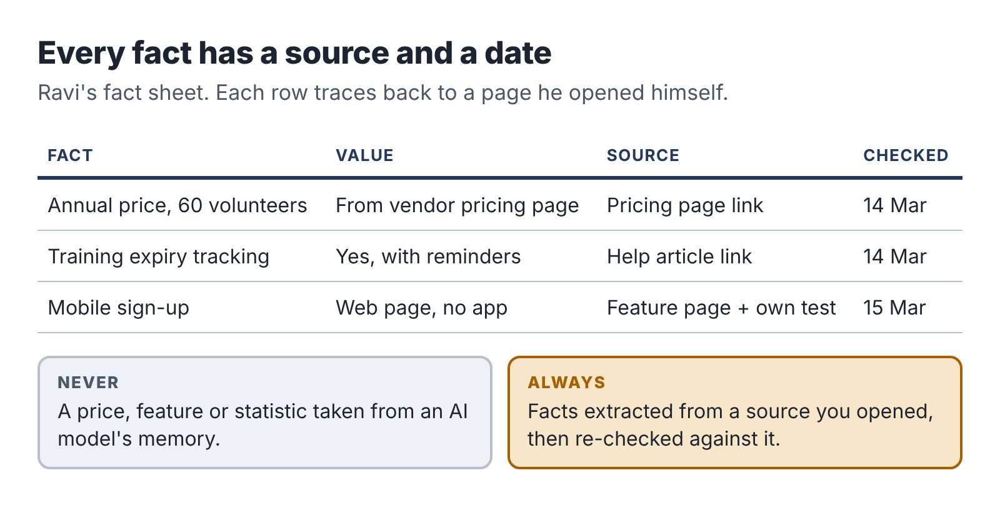

# 9. Pilot two: a research brief someone can trust

In early 2023, lawyers for a passenger suing an airline in a New York federal court filed a brief that cited half a dozen earlier court decisions that supported his client's position. The airline's lawyers could not find them. Neither could the judge. They did not exist. One of the lawyers had asked ChatGPT for relevant cases, and it had invented them, complete with plausible names, citations and quotations. When he asked whether the cases were real, the chatbot said yes. In June 2023 the judge fined the lawyers and their firm $5,000, and the case of *Mata v. Avianca* became the best-known warning about AI research.

It was not the last. A database kept by the researcher Damien Charlotin had logged roughly 1,600 court cases worldwide by mid-2026 in which filings contained AI-invented material, and the count was still rising by several a day.

If you sell research, that story is your business risk in one paragraph. A client who pays you for a research brief is paying for facts they can rely on. One invented statistic, one wrong price, one feature that a product does not actually have, and your brief is worse than useless, because the client trusted it.

This chapter follows Ravi's first Software Decision Brief and the verification routine that makes it trustworthy.

## The client and the question

Ravi's first client came from a volunteer coordinator he knew through a running club. She worked for a small animal-rescue charity with four staff and about sixty volunteers. They tracked volunteers, shifts and training records in a shared spreadsheet that had become unmanageable, and the board had asked her to recommend a proper system.

She booked the brief at $600. On the intake call, Ravi asked her five questions:

1. How do you handle volunteers today, step by step? Where does it break?
2. Who will use the new system, and how comfortable are they with technology?
3. What three things must the system do? What would be nice but not essential?
4. What is the budget, per month or per year, including any setup?
5. Who makes the final decision, and what will they want to see?

The answers set the frame for the whole brief. The must-haves were self-service shift sign-up for volunteers on their phones, tracking of training certificates with expiry dates, and an export for the charity's annual report. Budget: up to $1,000 a year. Decision-maker: a board of seven trustees, two of whom were skeptical about paying for software at all.

## Session 1: framing and the long list

Ravi's first session produced two things: a criteria table and a long list.

The criteria table turned the intake answers into a scoring frame: the three must-haves, four nice-to-haves (an app for coordinators, email reminders, a free tier, data hosted in their own country), cost for sixty volunteers, and ease of use. He weighted the must-haves heavily and wrote down, before he looked at a single product, what would disqualify an option.

Writing criteria before research is the most important habit in comparison work. If you look at products first, you will unconsciously build criteria that favor whichever one impressed you.

For the long list, he used his AI assistant and a search engine together. He asked the assistant for volunteer-management tools suitable for small charities, then searched independently, and looked at two charity-sector forums where people discuss tools. The combined list had eleven products. He cut it to five by checking each product's own website for the must-haves, which took about 40 minutes.

## Session 2: gathering facts with provenance

This is where most AI-assisted research goes wrong, and where Ravi's routine starts.

For each of the five products, he built a *fact sheet*: a table with one row per fact and four columns.

| Fact | Value | Source | Checked on |
|---|---|---|---|
| Price for 60 volunteers | $X per month, billed yearly | Vendor pricing page (link) | 14 March |
| Training expiry tracking | Yes, with reminder emails | Vendor help article (link) | 14 March |
| Volunteer mobile sign-up | Web page, mobile-friendly; no app | Vendor feature page (link) | 14 March |

He used the AI assistant to speed this up in two ways. He pasted in the text of each vendor's pricing and feature pages and asked it to extract the facts relevant to his criteria into the table format. And he asked it to read long help-center articles and pull out whether specific features existed.

What he did *not* do was ask the assistant what each product costs or what it can do from memory. AI models are trained on data that may be months or years old, and software prices and features change constantly. More importantly, when a model doesn't know something, it often produces a plausible answer anyway. Every fact in Ravi's table came from a page he had opened himself, and every fact has its source next to it.

## Session 3: the verification pass

With five fact sheets filled in, Ravi did a verification pass. It took most of a two-hour session, and it is what the client is really paying for. He did five things.

*He checked every extracted fact against its source.* Even when an AI tool extracts facts from text you give it, it can misread. In Ravi's fact sheets, the assistant had made two errors across about ninety facts: it had read a per-user price as a flat monthly price, and it had attributed a feature from a higher pricing tier to the basic tier. Both would have changed the recommendation.

*He confirmed prices in the vendors' own currency and for the right number of users.* Several tools priced by "active volunteer," one by "admin user," one had a free tier capped at fifty volunteers. He calculated the annual cost for sixty volunteers for each option and showed the calculation.

*He looked for what the vendor pages didn't say.* Vendor websites present the best case. Ravi read recent reviews on two independent software-review sites and searched forum discussions for each product name plus words like "problem," "cancel" and "support." He noted recurring complaints with links, labeled clearly as user reports, not established facts.

*He tested the free trials.* For the two front-runners, he signed up for free trials with his business email and spent twenty minutes in each, signing up as a fake volunteer on his phone. One product's "mobile-friendly" sign-up page was, in practice, hard to use on a small screen. That observation went into the brief, labeled as his own test.

*He dated everything.* The brief's cover page says: *All prices and features were checked between 14 and 16 March. Software vendors change prices and features often; please confirm current terms before you sign.*

## Session 4: writing the recommendation

Only after the verification pass did Ravi write the brief. He used the AI assistant to draft the structure and the comparison table from his verified fact sheets, then wrote the analysis and recommendation himself.

The brief had seven parts:

1. The recommendation in one paragraph, on the first page. Trustees read the first page; some only read the first page.
2. What you asked for: the must-haves, nice-to-haves and budget, in the charity's own words.
3. Summary table: five options against the criteria, with the annual cost for sixty volunteers.
4. The two front-runners in detail: strengths, weaknesses, his own trial notes and the user-reported issues.
5. The other three: a short paragraph each on why they were not recommended.
6. Risks and next steps: what to check in the contract, how to export data if they leave, how to run a one-month pilot with five volunteers before committing.
7. Sources: every link, grouped by product, with the date checked.

He addressed the skeptical trustees directly in the recommendation by including the cost of *not* switching: the coordinator spent roughly five hours a week maintaining the spreadsheet and chasing expired training records. At even a modest hourly value, the recommended tool paid for itself many times over.

## The writing check

The final check is easy to skip and should not be. Ravi read the brief from start to finish looking for one thing: *any sentence that states a fact without a source.* AI-drafted prose has a habit of slipping in general claims that sound like common knowledge ("most charities find that..." or "this is the market-leading tool for...") which no one has checked. He found three such sentences in the draft and either sourced them or deleted them.

He also checked every link worked and pointed to the page he claimed it did.

## Delivery and what happened next

The coordinator presented the brief to her board. The trustees approved the recommended tool with one change: they wanted to start with the free tier for three months, which the brief had listed as an option. Two weeks later, the coordinator emailed Ravi to say the board chair had asked for "whoever did that report" to look at their donor database next.

Ravi's time log for the project:

| Activity | Hours |
|---|---|
| Finding the client and intake call | 1.5 |
| Proposal, booking, invoices | 0.5 |
| Criteria and long list | 1.5 |
| Fact sheets with AI extraction | 2.0 |
| Verification pass, reviews, trials | 2.5 |
| Writing and final checks | 2.0 |
| **Total** | **10.0** |

Direct costs were $25. The project paid $575 for ten hours, about $57 an hour before tax, on a first project.

## Ravi's verification routine

The routine works for any research service. Copy it.

::: box
### The research verification routine

1. Write the criteria before you research.
2. Never accept a fact from an AI model's memory. Facts come only from sources you open.
3. Record every fact with its source link and the date you checked it.
4. Re-check every AI-extracted fact against the source text.
5. Recalculate every number yourself, showing the method.
6. Look for what the source doesn't say: independent reviews, forums, your own test.
7. Label opinions, user reports and your own tests as such.
8. Before delivery, read for unsourced claims and delete or source each one.
9. Click every link.
10. Date the brief and tell the reader to confirm current terms.
:::

## Keeping it public and clean

Ravi's conflict boundaries from Chapter 3 shaped how he worked. He used only public information and free trials. He never accepted anything from vendors, not even a demo call with a salesperson, so that his brief stayed independent; he said so in his offer. And he never referred to anything he had learned through his day job.

If your research service touches a field where you work, apply the same standard. If a fact is in your head only because of your job, it does not go in a client brief.

::: session
## Your next session

If your service involves research, comparison or any factual claims:

1. Write your intake questions.
2. Build a fact-sheet template with fact, value, source and date columns.
3. Run a small sample brief using the verification routine, and note how many errors the verification pass catches.
:::
