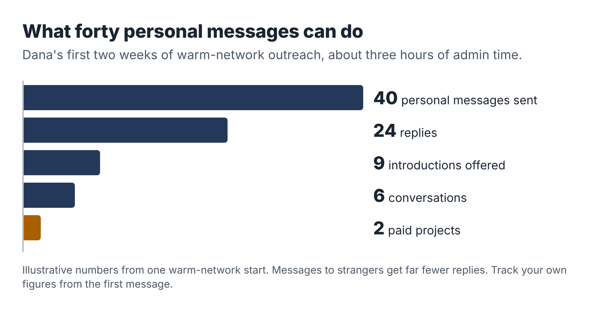

# 11. Find your first three buyers

Most new service businesses have the same first month. The owner builds a website, sets up social media profiles, posts a few times about their new venture, and waits. Nothing happens. A few friends like the posts. After six weeks they conclude there is no demand.

There usually is demand. It just doesn't find you in the first months. You have to go and find it, one conversation at a time, and on five hours a week you have to do that efficiently. This chapter shows you how.

## Where first clients actually come from

For employed people starting a small service, the first three clients almost always come from one of four places, roughly in this order of usefulness:

1. People you already know, outside your employer: former colleagues who have moved on, friends, family, neighbors, people from clubs, faith groups, schools and volunteer work. You are not asking them to buy. You are asking who they know.
2. Communities where your buyers gather: trade associations, local business groups, chambers of commerce, nonprofit networks, online forums and groups for your target profession.
3. Direct, personal outreach to specific businesses that clearly fit your buyer profile, with a message written for them.
4. Freelance marketplaces such as Upwork or Fiverr, where buyers post projects and freelancers compete.

What is not on this list: a website, paid advertising, posting on social media and hoping. Those can help later. In the first ten weeks, they mostly use up time.

## The warm network, done properly

Start with a list. Write down every person you know who has nothing to do with your employer's business and who might know someone in your buyer group. Aim for fifty names. People are usually surprised how many they have once they include old colleagues, school friends, neighbors, relatives and people from their hobbies.

Then send each one a short, personal message. Not a mass email; one message per person, mentioning something specific to them. The message has three parts: what you are doing, who it is for, and a specific, easy request.

> "Hi Sam, hope the new job's going well. Small news from me: alongside my job, I've started helping small trade businesses get their processes written down, so new staff can do jobs properly without phoning the boss every five minutes. I've put together a short example (attached). Do you know any plumbers, electricians or cleaning company owners who are hiring or tired of training people? I'd be grateful for an introduction, even just a name."

Notice what this message does. It doesn't ask Sam to buy. It doesn't ask for a "chat about synergies." It gives Sam something concrete (the sample) and asks for one specific, easy favor. People like helping when the request is clear and the sender has made it easy.

Dana sent 40 messages like this over two weeks of admin hours. Twenty-four people replied. Nine offered an introduction. Six introductions led to a conversation. Two of those conversations became paid projects in her first month, including Gary from Chapter 8, whom she knew directly.

## The sample does the selling

The sample you built in Chapter 6 is your most powerful sales tool, because it replaces a description with evidence. Attach it to introductions. Bring it to conversations. Post it, with permission from anyone involved, in communities where your buyers gather.

Ravi's sample brief on volunteer-scheduling tools for a fictional animal shelter did more for him than any message could. He offered it free in two online groups for charity managers, with a short note: "I put this together as an example of the kind of decision brief I write for small nonprofits. Happy for anyone to use it." It was downloaded more than a hundred times, and four people messaged him about their own decisions.

Giving away a useful sample can feel like giving away the product. It isn't. The sample shows what your work looks like. The client still needs the same thing done for their own situation, and now they know who to ask.

## Direct outreach that people answer

When your network runs dry, write to businesses directly. The key word is *directly*: one business at a time, researched, with a message that shows you looked at them specifically.

Teresa's approach is a good model. She looked for wedding photographers in her region whose websites had a contact form and no sign of fast replies, and who had a reasonable number of recent reviews (meaning they were busy). For each, she spent five minutes looking at their site and reviews, then sent a short message through their contact form, which, neatly, let her see how fast they replied.

> "Hi Maya, I love the lake-wedding gallery on your site. I set up enquiry systems for independent photographers so every couple gets a warm, personal reply within a couple of hours, even when you're mid-shoot, and nothing goes out without your OK on your phone. I've made a two-minute video of how it works, linked below. If slow replies ever cost you a booking, I'd be happy to show you how it would work for you. No pressure either way. Teresa"

She sent thirty of these over three weeks. Seven replied (most took more than a day, which made her point for her). Three agreed to a call, and two of those booked.

The rules for direct outreach are short. Write to one specific person. Mention something real about their business. Describe the outcome, not your process. Include the sample or a link to it. Ask for one small next step. Don't follow up more than twice, and always make it easy to say no.

## Freelance marketplaces: useful, with care

Marketplaces like Upwork and Fiverr connect buyers with freelancers at scale. They can work for an evening business, especially for research, spreadsheet, rewriting and translation services where buyers are comfortable buying from strangers. They also have real drawbacks.

They take a cut. Fiverr takes 20 percent of what the buyer pays. Since 2025 Upwork has charged freelancers a variable fee per contract, ranging up to 15 percent. You pay to submit most proposals on Upwork, too.

They are competitive on price. You will be bidding against freelancers from around the world, some in countries where a much lower price is a good income.

They are visible. A public profile with your full name and photo is easy for colleagues and managers to find. Make sure it is consistent with whatever you have disclosed at work.

If you use a marketplace, use it like a specialist. Build one profile around your one offer, with your sample, and bid only on projects that match it closely. Don't compete for generic "AI writer" jobs. A narrow, well-evidenced profile will win fewer projects at better prices, which is exactly what a five-hour business needs.

## The numbers game, honestly

Finding clients is a numbers game, but the numbers are smaller than people fear when the outreach is personal. Here is what a realistic first outreach campaign looks like, using warm-network numbers like Dana's. Cold outreach to strangers will have much lower reply rates.

Forty personal messages, at about five minutes each, is a little over three hours of admin time spread across two or three weeks. If that produces one or two paid projects, it is an excellent use of the time. Track your own numbers from the start; they will tell you where to spend effort next.

## What not to do

*Don't approach your employer's clients, suppliers or colleagues* as buyers, unless your employer has explicitly agreed. Chapter 3 explained why.

*Don't announce your business in a big public post* before you have thought through your disclosure at work. A post on a professional network reaches your manager's feed too.

*Don't give away your time.* A free sample is fine; free custom work is not. "Could you just do one for us so we can see?" is a polite way of asking for unpaid work. Point to your sample, and if they want something specific, offer a smaller paid version.

*Don't pitch AI.* Buyers care about their problem, not your tools. "I use the latest AI models to optimize your operations" sounds like everybody else. "Three procedures your new staff can follow without calling you" sounds like a solution.

*Don't follow up endlessly.* Two polite follow-ups, a week apart, is enough. Then move on and stay friendly. People come back months later more often than you'd expect.

## Your first three are different

Your first three clients are not typical clients. They are partners in your experiment. They are taking a chance on someone new, and in return you are learning from them. Be open about that. Many service providers offer their first two or three clients a pilot price, a little below their intended price, in exchange for honest feedback and, if the client is happy, a testimonial and permission to describe the project.

Say it plainly: "You're one of my first clients for this service, so I'm offering it at $450 instead of my usual $600. In return, I'd ask for 15 minutes of honest feedback at the end and, if you're happy, a short testimonial." Most people respect the honesty. And it gives you a clear, kind way to raise the price for client number four.

::: session
## Your next session

1. Write your list of fifty people in your warm network who are clear of your employer.
2. Draft your introduction message, adapted for different groups (former colleagues, friends, community).
3. Send the first ten messages in your next admin hour. Track who replies.
4. Find two communities where your buyers gather and join them.
:::
