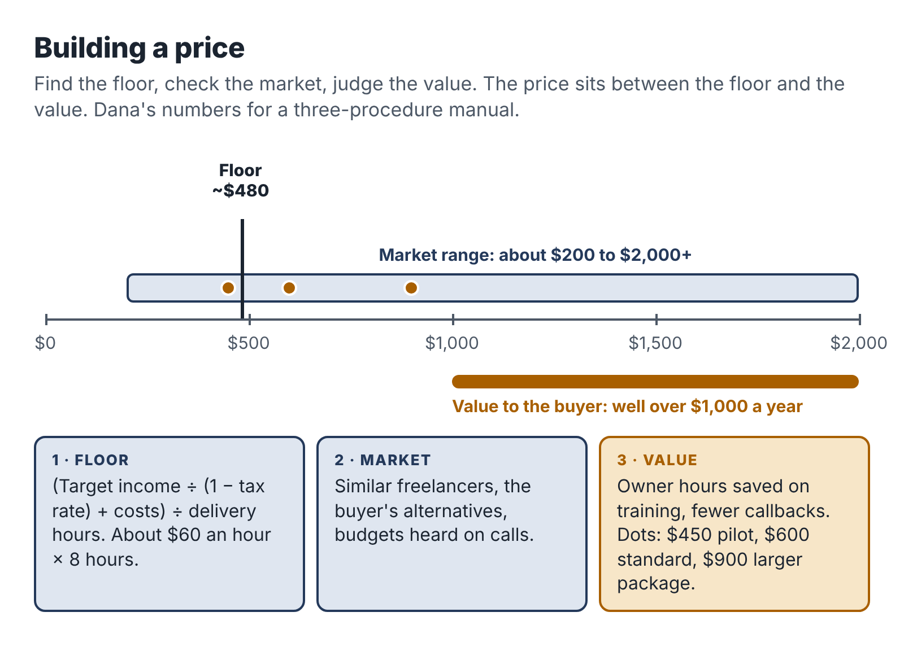

# 13. Price it without guessing

Ask new freelancers how they set their price and most will say some version of "I looked at what others charge and went a bit lower." It is an understandable instinct and a bad method. It ignores what your time costs, what the work is worth to the buyer and whether the business can survive on the result.

This chapter gives you a better method in three steps: find your floor, check the market, then look at the value to the buyer. Your price sits somewhere between the floor and the value.

## Step 1: find your floor

Your floor is the lowest price at which a project is worth doing. Below it, you are paying to work.

Start with an example. Say a project pays $200. It costs you $30 in direct costs (a share of your AI subscription, transcription, software), and it takes six hours in total, counting the client conversation, the work, the revisions and the invoicing. The project paid you $170 for six hours: about $28.33 an hour, before tax. After setting aside tax, it may be closer to $20.

Whether that is acceptable depends on you, but notice how quickly a price that sounds reasonable ($200!) shrinks once you count every hour and every cost. That is why you work the floor out from the other end.

### The monthly method

1. Decide what you want the business to pay you each month, after tax. Be modest for the first year. Say $500.
2. Gross it up for tax. If you expect to set aside about 30 percent of your profit for tax (Chapter 15 explains how to estimate this), you need $500 ÷ 0.70 = about $714 of profit.
3. Add your monthly costs. Tools, subscriptions, a share of your phone and internet, insurance. Say $60. Now you need about $774 of revenue.
4. Work out your delivery hours. Five hours a week is about 21.7 hours a month. Not all of those are spent delivering paid work. Finding clients, writing proposals, admin and learning take a large share, especially at first. Assume about 60 percent of your time is delivery: about 13 hours a month.
5. Divide. $774 ÷ 13 hours = about $60 per delivery hour.

That is your floor: about $60 for every hour of delivery work a project needs. A project that takes eight hours to deliver should be priced at no less than about $480.

If you want the business to pay you $1,000 a month after tax on the same hours, the floor roughly doubles: $1,000 ÷ 0.70 = about $1,429, plus $60 in costs makes about $1,489, divided by 13 hours is about $115 per delivery hour.

That second number surprises people, and it should. It means that a substantial side income on five hours a week requires either more hours, a higher-value offer or much faster delivery. Knowing this now saves you from building a business that can never pay what you hoped.

## Step 2: check the market

Your floor tells you what you need. The market tells you what buyers are used to paying. Look at three things.

*What freelancers charge for similar work.* Search freelance marketplaces and the websites of independent providers for services like yours. Note the range, and ignore the very bottom, which often comes from people who are underpricing or delivering poor work.

*What the buyer's alternatives cost.* What would it cost the client to do this themselves (their hourly value multiplied by the hours), to have a staff member do it, or to hire an agency? A plumbing firm owner who values his time at $80 an hour and would need fifteen hours to write three procedures is looking at $1,200 of his own time, before counting the fact that he will never actually find those fifteen hours.

*What you have seen in your own conversations.* After a few discovery calls, you will have a sense of what budgets look like. Write down every budget a prospect mentions.

If your floor is far above the market, you have three options: reduce the delivery hours (better templates, better prompts, a narrower scope), choose a buyer with more at stake, or accept that this particular offer can only be a learning project. If your floor is well below the market, good: you have room to price higher.

## Step 3: look at the value

The value to the buyer is the most important number and the hardest to pin down. Ask: what is this worth to them over the next year?

For Teresa's photographers, it is unusually clear. Lucia was losing two or three bookings a year at about $3,000 each. If the enquiry system saves just one booking a year, it is worth $3,000. Teresa's price of $750 is a quarter of that, and Lucia can see it.

For Dana's trade businesses, it is less direct but still real: fewer phone calls from new staff, faster training, fewer callbacks to fix mistakes, and a business that is easier to sell one day. Dana asks owners in discovery calls, "How many hours did you spend training your last new hire?" The answer is often 20 or 30 hours of the owner's time.

For Ravi's nonprofits, the value is avoiding a bad software decision that would cost a year of subscription fees, several weeks of staff time on migration and a lot of frustration.

You don't need to price at a fixed share of the value. You need to know the value so that you can explain your price confidently and so that you never charge a price that looks large next to what the client gains.

## Setting the number

Put the three steps together:

- Floor: the lowest price at which the project is worth your time.
- Market: what similar services cost and what clients expect.
- Value: what the outcome is worth to the client.

For a first pilot, price at or a little above your floor, within the market range, and well below the value. As you complete projects, gather testimonials and get faster, move your price toward the middle of the market and then beyond it, especially for a narrow specialty.

Dana's own pricing went like this. Her floor for an eight-to-ten-hour delivery was about $480 to $600. Similar documentation work from freelancers ranged widely, from about $200 to over $2,000 for a set of procedures. The value to a trade-business owner was clearly over $1,000. She set her pilot price at $450 for her first two clients, in exchange for feedback and testimonials, with a planned price of $600, which she reached by her third client. By her fifth project she was charging $900 for a slightly larger scope.

## Hourly, fixed or monthly?

For the kind of service this book describes, **fixed prices** are almost always the right starting point. They are easier to sell, they reward you for getting faster, and they fit the fixed-scope offer.

*Hourly pricing* makes sense for genuinely open-ended work, such as ongoing support or ad-hoc requests. If you use it, set a minimum (for example, one hour) and a cap the client agrees in advance.

*Monthly retainers* suit ongoing work like Teresa's support plan: a small, predictable fee for a defined amount of availability. Define exactly what is included, and keep the commitment small enough to fit your capacity. A retainer that needs ten hours a month on top of project work will break your five-hour budget.

## Offering options

Once your basic offer is established, you can offer two or three versions at different prices. Dana eventually had three:

- Starter: three procedures, $600.
- Standard: six procedures plus a simple onboarding checklist, $1,100.
- Complete: up to twelve procedures, onboarding checklist and a training session with the team, $2,000.

Options let clients choose the scope that fits their budget, and many choose the middle one. Keep it to three at most, and only add options once you have delivered the basic version several times. Each new option is something you must deliver well.

## Getting paid

Pricing is only half the job. You also need to collect.

- Ask for a deposit. Fifty percent before you start is standard for small fixed-scope projects.
- Invoice promptly. Send the final invoice with the delivery, not a week later.
- Make paying easy. Offer bank transfer and at least one card or online payment option. Card processing typically costs a few percent of the invoice; include it in your costs.
- State due dates. "Due within 14 days" is common for small businesses.
- Follow up calmly. A friendly reminder the day after the due date, a firmer one a week later. Most late payments are disorganization, not dishonesty.
- Know your rights. Some places have freelancer payment laws (Chapter 12), and most countries have small-claims processes for unpaid invoices.

Late and missing payments are a real problem for freelancers. A 2015 survey for the Freelancers Union found that 71 percent of American freelancers had struggled to collect payment for their work at some point. Deposits and clear terms prevent most of it.

## Raising your price

You should expect to raise your price several times in your first year. Good moments to do it:

- after your first two or three pilot clients;
- when you have two or more testimonials;
- when demand exceeds your capacity cap and you have a waiting list;
- when you add something to the offer that saves the client more;
- once a year, as a matter of routine.

Raise prices for new clients first. For existing clients, give notice and, if you like, honor the old price for their next project. Few clients leave over a reasonable increase, and the ones who do often weren't a good fit anyway.

::: session
## Your next session

1. Calculate your floor using the monthly method, with your own target, tax rate, costs and hours.
2. Research the market: find at least ten comparable services and note their prices.
3. Estimate the value to your buyer and write it in one sentence you could say on a call.
4. Set your pilot price and your planned standard price.
:::
