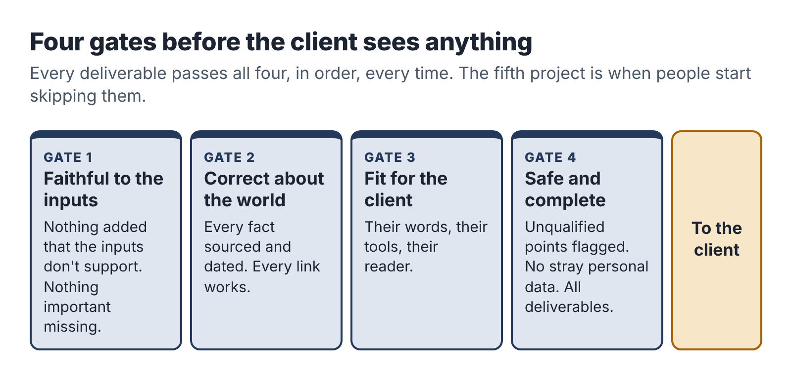

# 14. Deliver work you can sign your name to

A client who hires you is trusting you with two things: their problem and their information. This chapter is about honoring both. It covers how to handle client data safely when AI tools are involved, how to talk honestly about your use of AI, and how to check, deliver and close a project so the client comes back and tells their friends.

## Agree the rules before you touch anything

Before any client material reaches you, agree in writing how you will handle it. Your proposal's process note and your terms of business do most of this. For a small project, a short paragraph is enough:

> "I use AI tools to transcribe, summarize and draft, and I review and edit everything myself before you see it. I use paid accounts with settings that keep your content out of model training. Please don't send me passwords, customer contact details or anything you'd rather I didn't see; if the work needs them, we'll agree a safe way to handle them. Your files are stored in a private folder and deleted 30 days after the project ends unless you ask me to keep them."

Some clients will have their own rules: a ban on certain AI tools, a requirement to use their own accounts, a non-disclosure agreement, or (for larger clients) a data processing agreement. Read anything they send carefully, and if a rule makes the project impossible at your price, say so before you start, not halfway through.

## Minimize what you collect

The safest data is data you never had. For every project, ask what information you actually need and collect no more.

- Ask clients to remove customer names, contact details and account numbers from anything they send. If they can't, remove them yourself before using any AI tool.
- Replace names with roles ("Customer A," "the site manager") in transcripts and documents.
- For spreadsheets, work on a copy with only the columns the task needs.
- For automations, send the AI only the fields it needs to do its job, as Teresa did.
- Never paste passwords or login details into an AI tool, a document or an email. If you need access to a system, ask the client to create a temporary account for you and remove it at the end.

If you work with personal data about people in the European Union or the United Kingdom, data protection law (the GDPR and its UK version) applies to how you handle it, even as a one-person business. In practice, for most small projects, minimizing data, keeping it secure, using it only for the agreed purpose and deleting it when done covers the main obligations. If your service involves significant amounts of personal data, take advice and consider whether the client needs a formal agreement with you.

Some data should be treated with extra care whatever the law says: health information, information about children, financial account details and anything the client marks as sensitive. If your service touches these, think hard about whether AI tools belong in the workflow at all for that part of the work.

## Tell clients how you use AI

Chapter 1 described the myth that you should hide your AI use. You can be open about it without underselling yourself.

Describe your process in terms of what the client receives. AI tools do some of the mechanical work; you are responsible for the result. For example:

- "I use AI to transcribe the interview and produce a first draft. Then I review every step against what you said, fill in gaps, check anything that matters for safety with you, and write it in your team's language."
- "AI helps me gather and sort public information quickly. Every fact in the brief is checked against its original source and dated, and the recommendation is mine."
- "The system uses AI to draft replies in your voice. You approve every one before it goes out."

Most clients respond well. Many are curious and some are relieved, because they assumed everyone uses these tools now and would rather know how. A few will ask you not to use AI at all; that is their right, and you can either price the work done without AI or decline.

Some sectors have explicit rules or expectations. Some grant funders ask whether AI was used in applications; some publishers and institutions require disclosure; some courts now require lawyers to certify how filings were prepared. If your client works in such an area, ask about their rules at the start.

## The quality gates

Every project should pass through a set of checks before the client sees it. Chapter 8 showed Dana's line-by-line review and Chapter 9 showed Ravi's verification routine. Here is a general version that fits most AI-assisted services.

### Gate 1: Faithful to the inputs

Does the deliverable say only what the client's material supports? Have any facts, steps or claims crept in from the AI's general knowledge? Are all numbers correct and calculated by you? Is anything important from the inputs missing?

### Gate 2: Correct about the world

Is every external fact sourced and checked? Are dates, prices, names and references correct? Do all links work? Have you labeled opinions and your own tests as such?

### Gate 3: Fit for the client

Is it written in language the intended readers use? Does it match the client's brand, terms and tools? Does it do what the client said they needed in the discovery call? Would the client's newest employee, skeptical trustee or busy customer understand it?

### Gate 4: Safe and complete

Have you flagged anything you aren't qualified to judge (safety, legal, financial points)? Is any personal or sensitive data that should have been removed still in it? Are all the deliverables in the offer included, in the agreed format? Have you checked spelling, formatting, file names and that it opens on the client's devices?

Write the gates as a checklist and go through it every time. On your fifth project you will be tempted to skip it, because you know what you are doing. That is exactly when mistakes get through.

## Revisions without resentment

Your offer includes a defined number of revisions. Handle them in a way that keeps the client happy and the scope intact.

When a revision request arrives, sort it into one of three kinds:

- Corrections (something you got wrong): fix them promptly and without fuss, even if the revision round is used up. Mistakes are on you.
- Adjustments (the client wants something within the scope done differently): these are what the revision round is for.
- Additions (new work outside the scope): thank the client, explain kindly that it's outside the agreed scope, and offer a price. "Happy to add a fourth procedure for the van stock check. That would be $150, delivered by the 20th. Shall I go ahead?"

Most clients understand the difference once you name it. The ones who don't are telling you something useful about whether you want to work with them again.

## Sign-off and handover

When the deliverables are final, ask the client to confirm in writing that the project is complete. An email reply saying "All good, thanks!" is enough. This closes the revision window and protects you from requests months later.

At the same time, hand over everything they need: final files in the agreed format, any guide for using what you built, and a reminder of how long you'll keep their files before deleting them.

If you had temporary access to any of their systems, remove it, ask them to change any passwords you used and confirm that you've done so.

## Ask for feedback and a testimonial

Close every project with two short questions, by email or in a final call:

1. "What worked well, and what would you change if we did this again?"
2. "If you're happy with the result, would you be willing to write two or three sentences I can share with future clients?"

To make the testimonial easy and useful, ask a specific question: "What was the problem before, and what's different now?" Testimonials that describe a real change ("New engineers used to phone me ten times a week. Now it's once or twice") persuade far better than general praise.

Always ask permission before you use a client's name, business name or details in your marketing, and respect a "no." Many small business owners are happy to be named; some prefer a description ("a 14-person plumbing firm").

## Keep a project log

For every project, keep a short log in its folder:

- dates of key events (booking, inputs received, delivery, sign-off, payment);
- time spent on each activity;
- costs;
- what went well, what went wrong, what you would change;
- prompts and templates you improved;
- the client's feedback.

The log takes ten minutes at the end of a project and is the raw material for the next chapter, where you measure what the work really paid.

::: session
## Your next session

1. Write your data-handling paragraph for proposals.
2. Write your four quality gates as a checklist for your service.
3. Prepare your sign-off email and your feedback and testimonial questions.
4. Run your sample deliverable through the quality gates and fix anything that fails.
:::
