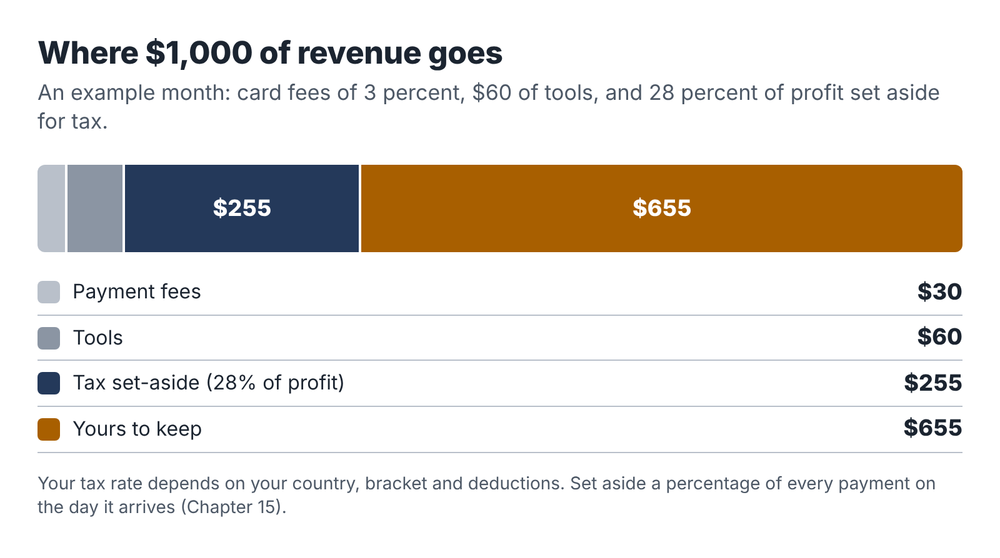

# 15. Money, tax and the boring paperwork

The first payment from a client feels wonderful. It is the moment the business becomes real. It is also the moment you take on a set of obligations that are easy to ignore and expensive to get wrong: recording income, setting aside tax, keeping receipts and filing the right forms.

This chapter covers the basics for a small service business run alongside a job. The details depend heavily on where you live, and tax rules change most years. Read this as a map of what to ask about, then check the current rules with your tax authority or an accountant. A one-off session with an accountant in your first year is cheap compared with fixing a mistake later.

## Separate the money from day one

Open a separate bank account for the business, even if you are not forming a company. Every client payment goes in; every business expense comes out. Your personal spending stays in your personal account.

This is the single most useful financial habit you can have. It makes bookkeeping almost automatic, it makes your tax return far easier, and it means that if your tax authority ever asks questions, you can answer them in an afternoon instead of a month. It also lets you see, at a glance, whether the business is actually making money.

Many banks offer free or cheap accounts for sole traders and freelancers. A second personal account used only for the business also works if a business account isn't practical.

## Choose a simple structure

In most countries, the simplest way to start is as an individual running a business in your own name: a sole proprietor in the US, a sole trader in the UK and many Commonwealth countries, or the local equivalent. You don't need to form a company to take on a few clients.

Some people form a limited liability company (in the US, an LLC; in the UK, a limited company) for liability protection or tax reasons. For a small side business, this usually adds cost and paperwork without much benefit at first, but it can make sense if your work carries real liability risk or your income grows substantially. Ask an accountant once you can see your first year's numbers.

Check whether you need to register a business name, get a local business license or register with your tax authority. In the US, many cities and counties require a business license even for home-based businesses. In the UK, you generally need to register for Self Assessment if your self-employment income goes above the £1,000 trading allowance in a tax year.

## Understand the taxes you will owe

When you are employed, your employer usually deducts tax from your pay. When you earn money from your own business, nobody does that for you. You are responsible for working out what you owe, setting it aside and paying it on time.

### In the United States

Profit from a side business is generally subject to two taxes:

- Income tax at your marginal rate, which is likely the same rate that applies to the top of your salary, because the side income is added on top.
- Self-employment tax of 15.3 percent on most of your net self-employment earnings (in 2026, the Social Security part applies up to an annual wage base, and the Medicare part has no cap). This covers the Social Security and Medicare contributions that an employer would normally split with you. You generally owe it once your net self-employment earnings for the year reach $400.

Many states add their own income tax.

Because no one withholds tax from your side income, you may need to make **quarterly estimated tax payments** to the IRS (and your state) if you expect to owe $1,000 or more for the year. An alternative many employed people use is to increase the withholding from their salary through a new W-4 form to cover the side income. Either way, the goal is to avoid an underpayment penalty and a large bill in April.

You may receive forms reporting your income. From the 2026 tax year, clients generally only have to send a Form 1099-NEC if they paid you $2,000 or more in the year, up from $600. Payment platforms and card processors issue a Form 1099-K only above $20,000 and 200 transactions. These thresholds affect paperwork only: **all business income is taxable whether or not you receive a form.**

### In the United Kingdom

Income from self-employment up to £1,000 a year can be covered by the trading allowance, with no need to report it. Above that, you register for Self Assessment, report your income and expenses, and pay Income Tax and Class 4 National Insurance on your profit. Because you are also employed, your personal allowance is likely already used by your salary, so your profit is taxed at your marginal rate from the first pound.

From April 2026, people with qualifying self-employment and property income over £50,000 a year must keep digital records and send quarterly updates to HMRC under Making Tax Digital for Income Tax, with the threshold falling to £30,000 in 2027 and £20,000 in 2028. Most side businesses in this book will be well below these levels at first, but it is worth knowing they are coming.

### Elsewhere

Most countries have a similar pattern: side-business profit is added to your other income, you may owe social contributions, and you are responsible for declaring it. Some have simplified regimes for small or micro businesses. Check with your tax authority's guidance for the self-employed.

## How much to set aside

Set aside a percentage of every payment in a separate savings account the day it arrives. In the US, many accountants suggest 25 to 30 percent of profit as a starting point for people with a middle-income salary; the right figure depends on your tax bracket, your state and your deductions. In the UK at 2025–26 rates, a basic-rate taxpayer pays about 26 percent on side-business profit (20 percent Income Tax plus 6 percent Class 4 National Insurance) and a higher-rate taxpayer about 42 percent, so setting aside 30 or 45 percent leaves a small margin.

Choose a percentage with an accountant's help if you can, and err on the high side. Finding you set aside too much is a pleasant surprise. The reverse is not.

## Track expenses

Legitimate business expenses reduce the profit you are taxed on. For a small AI-assisted service business, they often include:

- AI and software subscriptions used for the business;
- a share of your phone and internet costs, if you use them for the business;
- equipment bought mainly for the business (a laptop, a microphone), sometimes spread over several years;
- payment processing and marketplace fees;
- professional fees (an accountant, a lawyer reviewing your terms);
- insurance;
- training and books related to your business (including, perhaps, this one).

Keep a receipt for everything, ideally in a folder in your business storage, named with the date and supplier. Personal costs and items you'd have bought anyway are generally not deductible, and mixed-use items need a reasonable split. Rules vary, so ask.

## Bookkeeping in fifteen minutes a week

A small side business doesn't need complicated bookkeeping. It needs a habit. In your admin hour each week:

1. Record every payment received: date, client, invoice number, amount.
2. Record every expense: date, supplier, what for, amount, and save the receipt.
3. Move the tax percentage of any new income to your tax savings account.
4. Check for unpaid invoices and send reminders.

A spreadsheet works fine for the first year. Accounting software designed for freelancers can connect to your business bank account, categorize transactions and produce invoices, which saves time once you have more than a handful of clients. The Toolkit at the back includes a simple income and expense log.

## Insurance

Consider professional liability insurance (called professional indemnity in the UK and errors and omissions in the US). It covers claims that your work caused a client a loss. For research, documentation and automation work, the risk is usually modest but not zero. A recommendation that leads to a costly decision, or an automation that sends a wrong message, can lead to a claim. Some clients will require insurance before they hire you.

Also check whether your home insurance covers business equipment and business use of your home; many policies don't by default.

## Contracts and records

Keep a copy of every proposal, set of terms, client confirmation, invoice and payment record. Many tax authorities require business records to be kept for several years (in the US the IRS generally recommends at least three years, and longer in some cases; in the UK, HMRC requires at least five years after the filing deadline for the self-employed). A folder per year in your business storage, with subfolders for income, expenses and contracts, is enough.

## A note on benefits and your job

Two last checks. If you receive any income-related benefits or credits, side income may affect them; check before you start. And if your employer offers benefits linked to your salary (such as retirement contributions), these do not extend to your side income, so consider putting some of your business profit into your own retirement savings. In the US, self-employed people can use a Solo 401(k) or SEP IRA; elsewhere, look at the personal pension options available to the self-employed.

::: session
## Your next session

1. Open a separate bank account for the business and a separate savings account for tax.
2. Check what registration and licensing you need where you live.
3. Choose your tax set-aside percentage, ideally with an accountant.
4. Set up your income and expense log and your receipts folder.
:::
