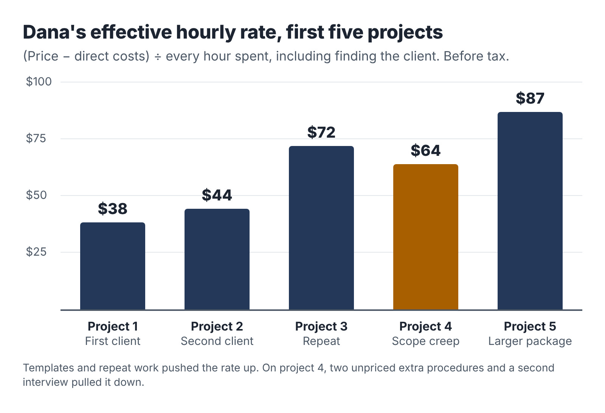

# 16. Measure the job you actually did

Here is a conversation that happens in a lot of households with a side business.

"How's the business going?"

"Great! I made $2,400 this quarter."

It sounds like a good answer. It is not a useful one. It doesn't say how many hours that took, what it cost, how much of it is owed in tax, or whether the work is getting easier or harder. A business that made $2,400 in 40 hours is doing well. A business that made $2,400 in 160 hours is costing its owner sleep for less than many entry-level jobs pay.

Measuring the business honestly is the only way to make good decisions about it.

## Count every hour

The most important number in an evening business is your **effective hourly rate**: what you earn for each hour you put into the business, after costs.

> Effective hourly rate = (revenue − direct costs) ÷ total hours

The hard part is "total hours." It means *every* hour the project took, including:

- the outreach that found the client;
- the discovery call and the proposal;
- preparation, research and the delivery work itself;
- revisions and corrections;
- calls and emails with the client;
- invoicing and chasing payment;
- any learning or setup that was specific to that project.

People tend to undercount, sometimes dramatically. They remember the four focused hours of drafting and forget the two hours of emails, the hour of searching for the client, and the forty-five minutes it took to fix a formatting problem at midnight. Your time log, kept as you go, is the only cure. Write down start and end times for every session and what you did. A simple spreadsheet or a time-tracking app both work.

## Dana's first five projects

Dana's project logs give this record for her first five projects.

| Project | Price | Costs | Hours | Effective rate |
|---|---|---|---|---|
| 1. Gary, three procedures | $450 | $30 | 11.0 | $38.18 |
| 2. Second client, three procedures | $450 | $30 | 9.5 | $44.21 |
| 3. Gary repeat, four procedures | $600 | $25 | 8.0 | $71.88 |
| 4. Referral, six procedures | $900 | $35 | 13.5 | $64.07 |
| 5. New client, six procedures | $900 | $30 | 10.0 | $87.00 |

Three things stand out.

*The rate rose quickly.* From about $38 an hour on the first project to $87 on the fifth. Two things did most of the work. Her templates and prompt library cut delivery time, and her price rose from the pilot rate to her standard rate and then to a larger package.

*Repeat work was the most profitable.* Project 3, a repeat booking from Gary, needed no outreach and almost no setup. Dana already knew how Gary talked, how his business worked and what his engineers needed. Repeat clients are often the most profitable work you will do.

*Project 4 went backwards.* The referral client added two "quick" procedures during the interview, and Dana, wanting to please, agreed without adjusting the price. She also needed a second interview because the owner's operations manager knew more about two of the jobs than the owner did. The project took 13.5 hours instead of the 9 or 10 she had planned. Her project log for that client has one line underlined: *Scope changes get a price before they get a yes.*

## The six numbers

Beyond the effective hourly rate, a small set of numbers tells you most of what you need to know. Track them monthly in your admin hour.

1. Revenue: money invoiced in the month.
2. Effective hourly rate: across all projects completed in the month.
3. Hours: total business hours, compared with your budget (about 21.7 a month on five hours a week).
4. Share of hours on delivery: delivery hours as a percentage of total hours. Early on, 50 to 60 percent is normal. If it stays below 40 percent for long, you are spending too much time selling or on admin.
5. Conversion: of the discovery calls you had, how many became paid projects?
6. Days to payment: the average time from invoice to payment.

You don't need a dashboard. A single row per month in a spreadsheet is enough. The Toolkit includes a template.

## What the numbers tell you

Numbers matter only if they change what you do.

*If your effective rate is low*, look at where the hours went. If delivery hours are high, improve your templates and prompts, narrow the scope or raise the price. If selling hours are high, focus on warm introductions and repeat clients instead of cold outreach. If admin and revisions are high, tighten your offer's revision terms and your inputs list.

*If your hours keep going over budget*, something is giving way, and it is usually your sleep, your health or your day job. Reduce the number of projects, extend timelines, or raise prices so that fewer projects pay the same. Remember the capacity cap.

*If conversion is low*, the problem is usually fit or price. Are the people you speak to really your buyer? Is your sample convincing? Are you explaining value in their terms? Ask the people who say no.

*If payments are slow*, tighten your terms: a deposit, clear due dates, a reminder routine.

## Compare with your day job, honestly

At some point you will ask whether the business is "worth it." A useful comparison is your day job's effective hourly rate: your take-home pay divided by the hours you actually work, including commuting and the evening email.

If your business's effective rate after tax is well below your day job's, that is fine as long as you know it and have a reason. You might be learning, building toward something, or enjoying the work. If it stays well below for many months and you were hoping for income, that is important information for the decision in the next chapter.

Also count the things that are hard to measure: the skills you are building, the network you are growing, the satisfaction of doing work you chose, and the option it gives you to change your career one day. And count the costs that are hard to measure: tiredness, time away from family and friends, and the risk to your main job if you are stretched too thin. Write these down too. They belong in the decision.

## The monthly review

Once a month, in your admin hour, spend twenty minutes on a short review. Answer five questions in writing:

1. What did the business earn, and what was the effective hourly rate?
2. Did I stay within my hours budget? If not, why?
3. What took longer than it should have?
4. What one change would make next month better?
5. How am I feeling about the business, my job and my energy?

Keep the answers in one document, newest at the top. After three months you will have a clear record of what is working, and after six you'll be able to see trends that are invisible from week to week.

::: session
## Your next session

1. Set up your time log and start recording every business minute, including today's.
2. Set up the monthly six-numbers row and the five review questions.
3. Calculate your day job's effective hourly rate for comparison.
:::
