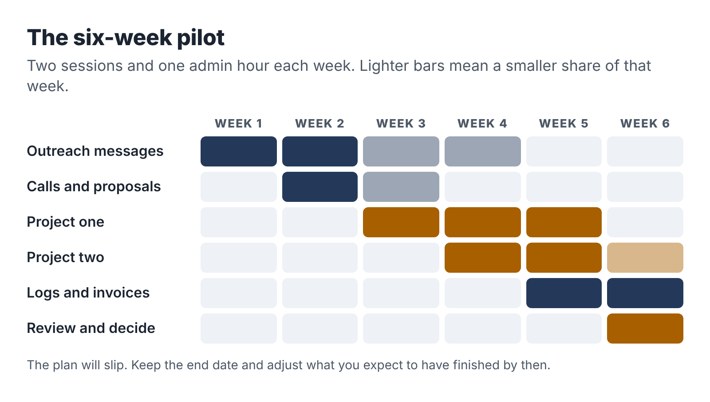
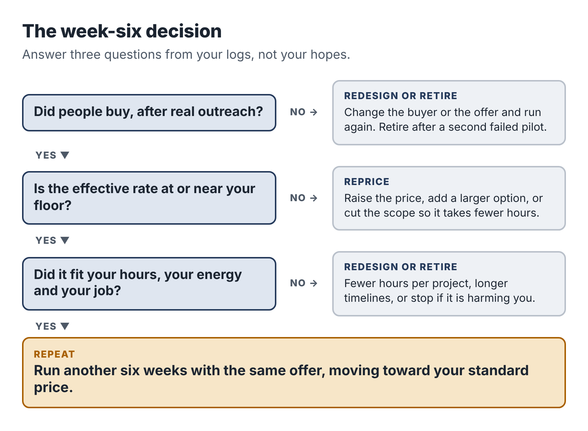

# 17. The six-week pilot and the decision

You now have everything you need: a time budget, a clean line with your employer, an offer, a sample, a tool kit, a way to find buyers, a proposal, a price, a delivery routine and a way to measure. This chapter puts it all together into a six-week pilot that ends with a clear, evidence-based decision.

Six weeks is long enough to find and deliver one or two real projects on five hours a week. It is short enough that you will not drift. And having an end date changes how you behave. You will send the messages you have been putting off, because the review is coming.

## Before the pilot starts

Check that you have finished the preparation from the earlier chapters. Most people need about four weeks of sessions to get here.

::: box
### Pilot readiness checklist

- Five hours a week blocked in your calendar, with a capacity cap and pause triggers (Chapter 2).
- Employer boundary checklist complete, any approvals obtained, exclusion list written (Chapter 3).
- One service chosen and written as an offer card (Chapters 4–6).
- A finished sample deliverable (Chapter 6).
- Tools set up on your own accounts, with a data note and a starter prompt library (Chapter 7).
- A delivery routine for your service, with quality gates (Chapters 8–10, 14).
- A warm-network list of fifty names and an introduction message (Chapter 11).
- Discovery questions, proposal template and terms of business (Chapter 12).
- Floor, pilot price and standard price calculated (Chapter 13).
- Business bank account, tax savings account and income log (Chapter 15).
- Time log and monthly review set up (Chapter 16).
:::

If something is missing, finish it first. Starting the pilot with half a setup usually means spending the pilot's sessions on setup instead of clients.

## The six weeks

Here is the plan, week by week. Each week has two working sessions (A and B) and an admin hour.

### Week 1: Start conversations

- Session A: Send fifteen personal introduction messages to your warm network. Share your sample in one community where your buyers gather.
- Session B: Send fifteen more messages. Polish your sample based on any reactions.
- Admin hour: Reply to responses. Book any discovery calls.

*Target by the end of the week: thirty messages sent, at least one call booked.*

### Week 2: Talk and propose

- Session A: Discovery calls (two or three short ones fit in a two-hour session). Write proposals the same evening.
- Session B: Ten to fifteen direct outreach messages to specific businesses, or targeted marketplace proposals. Follow up on week 1 messages.
- Admin hour: Send proposals, follow up on proposals, invoice deposits for any yes.

*Target: at least two proposals sent, ideally one accepted.*

### Week 3: Deliver the first project

- Session A: Intake or interview with the first client. Start the work.
- Session B: AI-assisted drafting and the first review pass.
- Admin hour: Client communication, any further discovery calls and proposals.

*Target: first project well underway; second proposal out if you haven't had a yes yet.*

### Week 4: Finish the first, start the second

- Session A: Complete the review and quality gates on project one. Send for client review.
- Session B: Start project two if you have one; otherwise, more outreach and refine your sample using what you learned.
- Admin hour: Client review call, revisions plan, invoices.

### Week 5: Deliver and collect

- Session A: Revisions and final delivery of project one. Request sign-off, feedback and a testimonial.
- Session B: Project two delivery work.
- Admin hour: Final invoice for project one. Update the project log and time log.

### Week 6: Review and decide

- Session A: Finish or schedule the remainder of project two. Complete your project logs.
- Session B: The pilot review (below).
- Admin hour: Write your decision and your plan for the next six weeks.

The plan will not run exactly like this. A client will take a week to send inputs; a discovery call will be rescheduled; your job will have a heavy week and a pause trigger will fire. That's fine. Keep the end date, and adjust what you expect to have done by then.

## The pilot review

In the second session of week 6, sit down with your time log, project logs, income log and outreach record and answer these questions in writing.

*Demand:* How many people did you contact? How many replied, had a call, received a proposal, bought? What did the people who said no tell you?

*Delivery:* How many hours did each project take, broken down by activity? What took longer than expected? Where did AI save the most time, and where did it create extra work?

*Economics:* What was the effective hourly rate for each project? How does it compare with your floor? What would it be with the improvements you can already see?

*Quality:* What did clients say? Did any mistakes reach a client? Did the quality gates catch what they should have?

*Fit with your life:* Did you stay within five hours a week? How did the business affect your energy, your day job and your relationships? Did any pause trigger fire?

*Interest:* Do you want to keep doing this work?

## The four decisions

The review leads to one of four decisions. Each is a good outcome, as long as it is based on the evidence.

### Repeat

Choose this when people bought, the work went well, the effective rate is at or above your floor (or clearly heading there), and it fit your life. Run another six weeks with the same offer, moving the price toward your standard rate and focusing outreach on whatever worked best.

### Reprice

Choose this when people bought and the work went well, but the effective rate is below your floor and the hours can't easily be cut further. Raise the price for new clients, add a larger option, or narrow the scope so it takes fewer hours. If the people who bought say the price was "very reasonable," that is a strong signal.

### Redesign

Choose this when something in the offer didn't work: the buyer was hard to reach, the inputs were unreliable, the scope kept changing, or the work took far more hours than expected. Keep what worked and change one major thing. You might switch to a different buyer for the same service, a different service for the same buyer, or a smaller, more defined scope. Then run another six-week pilot.

### Retire

Choose this when there was little or no demand after real effort, the economics can't work even with a higher price, or the business is harming your health, your job or your relationships. Retiring an offer is not failing. You learned something real about a market and about yourself, cheaply, in six weeks. Go back to your skill inventory from Chapter 4, choose your second idea, and run a new pilot when you're ready. Or decide that a side business isn't right for you at this stage of life, which is also a legitimate conclusion.

## How the three pilots ended

Dana chose **repeat**. Her first two projects paid a little below her floor, but repeat work and a referral were already coming in, and her templates were cutting her hours. She moved her price to $600 for new clients and planned a larger package.

Ravi chose **redesign**. He delivered two briefs, and both clients were delighted, but outreach was slow and, as Chapter 12 described, several prospects needed a faster turnaround for board meetings. He redesigned the offer into a five-day "Board-Ready Brief" with a narrower scope and the same price, and focused his outreach on two nonprofit networks where his free sample had done well.

Teresa chose **reprice**. Photographers loved the system and one referred another, but at $750 her effective rate on the build was around $50 an hour, below her floor because the testing took long. She raised the price to $950, kept the $40 monthly support, and created a reusable test set that cut her testing time in half.

None of the three is earning a fortune. All three are earning more per hour than when they started, from work they're proud of, within the hours they have, and with their jobs secure. That is what a successful pilot looks like.

::: session
## Your next session

1. Complete the pilot readiness checklist and finish anything missing.
2. Put the six-week plan in your calendar, with the review session in week 6.
3. Write the date of your decision session on the first page of your notebook.
:::
